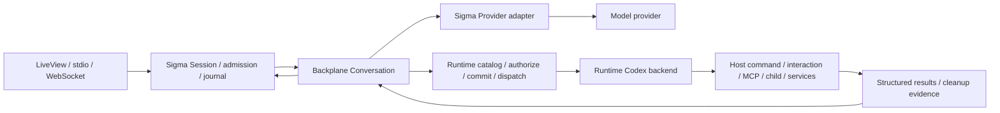
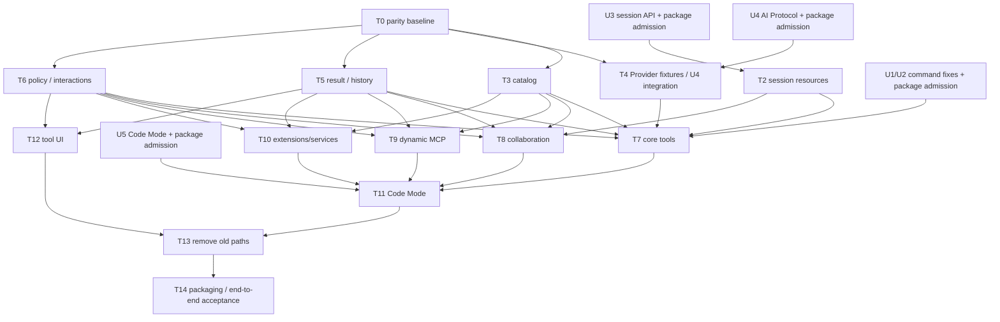

# Sigma Codex Tools Replacement Implementation Plan

> **For agentic workers:** REQUIRED SUB-SKILL: Use superpowers:subagent-driven-development (recommended) or superpowers:executing-plans to implement this plan task-by-task. Steps use checkbox (`- [ ]`) syntax for tracking.

**Goal:** 完整移除 Sigma 现有工具实现和旧工具执行路径，以 `backplane_agent_runtime` 的 Codex contracts、profiles 和执行内核提供工具；通过工具契约、实际行为、跨轮生命周期和端到端验证证明兼容性。

**Architecture:** Backplane Runtime 负责工具定义、admission、权限凭据匹配、预算、commit-before-dispatch、资源 fencing、执行和 settlement。Sigma 保留会话、Provider transport、用户配置、hooks、skills 来源、JSONL、Protocol 和 UI，提供受监督的宿主资源与薄适配。最终只保留 Backplane 执行路径，模型目录与执行授权来自同一份 Runtime catalog。

**Tech Stack:** Elixir / OTP、Phoenix LiveView、Backplane Agent Runtime / AI Protocol / MCP Protocol、DuskMoon、现有 native terminal helper；Code Mode backend 由上游 conformance 决定。

**Status:** 开发计划；截至 2026-10-07 尚未修改产品代码。用户已确定完整替换旧工具。上游能力关口必须先解决，不能把支持的函数名称等同于完整 Codex 行为。

## 1. 已核实的基线与范围

- Sigma：`main @ 7b30ca0a9f25146c5469b62fd87005fe1d7568c5`；Runtime 和 AI Protocol 均锁定 `1.10.4`。
- 已检查实际 Hex Runtime `1.10.11`：包含 Codex profiles；`lib/`、`priv/` 与 Backplane `main @ beaaf35c` 一致。
- 初始名称/注册基线：Runtime 打包的 `priv/codex/source-inventory.json`，Codex revision `46fdd5ef39735f4159cdcf0ec5e85c10521494e5`；66 项包含 65 production 注册项/模式及 1 项 test-only，不能解释为 66 个固定、全部开启的工具。
- 每条 parity 记录同时注明 source revision、schema/wire、行为 fixture、宿主 capability、平台、实际验收状态。若目标 Codex revision 更新，重新生成对照与差异，不能混用多个版本后声称相同。
- 本次范围涵盖全部工具 families 的宿主接入、旧实现删除、Provider、配置/hooks/skills 兼容、历史回放、工具展示与打包检查。
- 实施时所有 worktree 放在项目 `.trees/`；Mix/Devenv 构建串行，独立源码与 fixture 工作并行。
- 不重写历史 JSONL，不删除已有会话/用户配置；不重做 Session UI 布局；不实现无关 REST、数据库、模型目录功能。
- 外部 SaaS/MCP/插件的实例和凭据由用户配置；按 Codex 的条件暴露规则控制可用性。已配置的必需后端未通过验收时，对应 family 不能算完成。
- 本计划不执行发布、生产部署、live-provider 计费调用或安装插件。它们需要各自已授权的验收/交付任务。

## 2. 目标工具集合

| Family | 工具范围 | Sigma 的责任 | 完成标准 |
| --- | --- | --- | --- |
| Local | `exec_command`, `write_stdin`, `apply_patch`, `view_image`, `update_plan`, `clock::curr_time`, `clock::sleep` | workspace、command adapter、资源 owner、Plan、结果投影 | 真命令、stdin、PTY、patch、图片、计划及跨轮测试通过 |
| Interactive | sync/async user input、async user message、permissions、environment readiness、context reset/remaining | root UI、身份关联、授权、环境/context callbacks | Web/stdio/WS 等价；待答不会消耗执行期限；取消与重复回答有边界 |
| Collaboration | V2 spawn/message/followup/interrupt/list/wait；V1 按 source 条件提供 | child config、预算、权限子集、历史 fork、journal/store | 真实 child Conversation；跨轮 identity、隔离与清理通过 |
| Dynamic | MCP resources/templates/read、`tool_search`、插件查询/安装请求、动态 MCP 工具 | 已有 MCP client 与配置、宿主插件 adapter、admitted candidates | 新目录仅在正确 boundary 发布，旧调用保持旧 revision |
| Code Mode | custom `exec`、continuation `wait`、目标版本执行环境 helpers | backend capability、资源、输出与媒体投影 | 对照源实现的执行/续体/中断/隔离 fixtures；通过 #54 |
| Extensions | goals、memories、skills、history、notes、message boards | scoped 持久化 adapter；复用既有 skills/history | restart 后数据可读；权限/作用域隔离；无 secret/handle 持久化 |
| Services / Hosted | `web::run`, `image_gen::imagegen`；provider-hosted `web_search` | services、凭据、allowlist、Provider 能力声明 | 真实配置后端的协议与结果验收；hosted 不进本地 registry |

`test_sync_tool` 不进入生产目录。`dynamic::<host-defined>`、`mcp::<server-defined>` 和 board namespace 是注册模式，不硬编码成工具名称。缺失 capabilities 要明确诊断，不能返回成功的空结果冒充已实现。

## 3. 上游关口与阻塞范围

| 编号 | Issue | 当前证据 | 阻塞的任务 |
| --- | --- | --- | --- |
| U1 | [backplane#50](https://github.com/gsmlg-opt/backplane/issues/50) | trusted workspace/capacity non-start 被升级为 unknown_outcome，已复现 | T7 命令验收、T13 完整切换 |
| U2 | [backplane#51](https://github.com/gsmlg-opt/backplane/issues/51) | `tty:true` 在 adapter 前硬拒绝 | T7 PTY 及各目标平台验收 |
| U3 | [backplane#52](https://github.com/gsmlg-opt/backplane/issues/52) | run terminal 清理 run-owned 资源；没有跨 user-turn owner/transfer API | T2、T7 跨轮命令、T8 agent identity、T11 cell continuity |
| U4 | [backplane#53](https://github.com/gsmlg-opt/backplane/issues/53) | AI Protocol 拒绝 custom format、raw string 和 namespace，已执行最小复现 | T4 native freeform/namespace Provider 接入 |
| U5 | [backplane#54](https://github.com/gsmlg-opt/backplane/issues/54) | 当前 Code Mode 是 codex.tool/custom + generator yield；helper/运行语义尚有差距 | T11 Code Mode parity、全量完成声明 |

截至计划日期均 OPEN。U1/U4 是已执行的复现；U2/U3/U5 是当前源码/API 已确认的能力缺口，不伪称完成端到端复现。

处理规则：在 Backplane 独立任务中完成实现、回归、文档和包发布；Sigma 等待对应已发布修复包，并验证包内能力，不能只看 issue CLOSED。不得修改 `deps/`、绕过 validators、禁用 cleanup、复用 run ID 或弱化 uncertain effect 作为本地 workaround。阻塞一条任务时继续其他独立任务。

上游修复必须保留授权、catalog/descriptor revisions、approval 与参数摘要、预算、取消 fencing、intent commit before dispatch、unknown_outcome 和 bounded cleanup receipts。新增 Sigma 接入 callsite 后添加对应 `# TODO(upstream): gsmlg-opt/backplane#N`；关口通过后移除已完成标记。

## 4. 职责和接口



### 4.1 Catalog 与 Provider

现有公开 API 的集成形状如下；`host_context` 与 `authority` 全部由受信任宿主构造：

```elixir
alias Backplane.AgentRuntime.{Codex, Conversation}

{:ok, bundle} = Codex.profile(:configured, host_context, authority,
  families: selected_families,
  tools: selected_canonical_names
)

Conversation.start_link(
  run_id: turn_id,
  store: Sigma.Agent.Backplane.Store,
  context: store,
  provider: Sigma.Agent.Backplane.Provider,
  provider_context: provider_context,
  registry: bundle.registry,
  tools: bundle.tools,
  authority: bundle.authority,
  hosted_tools: Map.get(bundle, :hosted_tools, []),
  messages: canonical_messages,
  subscriber: event_owner,
  work: 100,
  run_timeout: 300_000,
  effect_timeout: 300_000
)
```

该片段描述当前 profile/Conversation API，不定义尚未存在的跨轮 API。T2 必须根据 U3 发布后的正式接口接入 session-owned resources。

- `registry/tools/authority` 是一个 admission bundle；禁止拼回旧 Sigma registry。
- `Provider.stream/2` 使用 Runtime 的当前 `request.tools` 和 catalog revision；不再从 `state.tools` 重建静态目录。
- Function arguments 是对象；custom arguments 是 raw binary，保留 grammar 与 namespace。流式 partial input 只聚合，completed 后才执行。
- 不支持 native custom tools 的 Provider 在请求前给出明确 capability error；不能偷偷把 patch/JS 包装成另一种 JSON 工具。兼容投影只有在目标版本允许且无损 fixtures 通过后才启用。

### 4.2 资源、结果与历史

- Session supervisor 承载宿主资源。run 是每次有限执行的身份；session 是资源与任务连续性的身份。两者不能合并。
- 自然完成、显式取消、session close、进程 crash、uncertain effect 分别处理。跨轮资源转移只能由 Runtime 已确认的接口完成，旧 run 的迟到消息不能控制新 run。
- canonical tool message 保留 `tool_call_id/name/result`，其中 result 是原始结构化证据；另做 Provider/UI 的展示投影。
- command 的 `session_id/status/exit_code/termination_status/cleanup_status`、输出截断信息必须保留；patch 保留 `files/uncertain_files`；图片传递真正 image content。
- JSONL 保留旧记录原文和旧名字展示；reload/fork/retry 不能因重放旧 tool call 而再次执行 shell/patch。
- 运行期 PIDs/functions/credentials/grants 不写入 journal；runtime sidecar 保留现有有限恢复边界，恢复读取不自动重执行工具。

### 4.3 权限、hooks、skills

- 工具同名不等于授权相同。执行时精确绑定 revision、参数与 approval；没有宿主 sandbox capability 时不得声称 OS sandbox 已生效。
- 旧策略保留原配置，同时产生新工具策略：`bash→exec_command`，`write/edit→apply_patch`；合并时 `deny > ask > allow`。
- `read/search/find/grep/glob/ls` 收敛到 shell 后无法保持逐工具权限精度，保守提升到 `exec_command` 的 deny/ask，并提供可见诊断；不能把旧 deny 静默变 allow。
- hooks 的旧 matcher 必须显式迁移/诊断。能够拒绝、改输入的 pre-hook 必须在准确的 Runtime admission 阶段生效；参数变化要重新验证并重新绑定 approval/commit。
- 当前 Runtime hooks 只有 prompt/stop。T6 若确认现有 API 不能安全承接上述 tool hook，按上游规则创建独立 blocker；不得在 commit 后替换 operation.arguments 或绕过 Runtime backend。
- 删除 `activate_skill` 后用 Codex `skills::list/read` 和原有程序化手动 invocation 承接。manual-only/disabled 策略、只读包资源、digest、grant 清理均保留。

## 5. 文件所有权与删除清单

以下路径相对 Sigma 根目录；新增模块是本计划的目标设计，不是声称当前已存在。保持现有 umbrella，不新增工具实现 app。

| 所有者 | 新建/修改范围 | 职责 |
| --- | --- | --- |
| Runtime owner | `apps/sigma_agent/lib/sigma_agent/backplane/{engine,provider,hooks}.ex`；新增 `tool_catalog.ex`, `resources.ex`, `tool_result.ex`, `collaboration.ex`, `extensions.ex`, `services.ex` | profiles、监督、结果、children 和宿主 callbacks |
| Integration owner | `apps/sigma_agent/lib/sigma_agent.ex`, `session_supervisor.ex`, `public_runtime.ex`, `context_builder.ex`, `protocol_event_mapper.ex`, `config/{runtime,test}.exs` | 唯一执行路径、会话状态和所有入口切换 |
| Provider owner | `apps/sigma_ai/lib/sigma_ai/{message,provider_event}.ex`, `providers/{openai_responses,openai,anthropic}.ex` 及对应 tests | custom/namespace、流式事件、能力门控、wire 投影 |
| Policy/history owner | `apps/sigma_coding/lib/sigma_coding/{permission_policy,permission_interceptor}.ex`, `hooks/**`, `mcp.ex`；`apps/sigma_session/lib/sigma_session/config_manager.ex`, `entry_{encoder,decoder}.ex`；新增 `tool_policy_migration.ex` | 旧配置、hook 语义、MCP adapter、历史读写 |
| Web owner | `apps/sigma_web/lib/sigma_web/{protocol_session_options.ex,live/session_live.ex}`；新增 `components/codex_tool_components.ex` 及对应 tests | 多问题、图片/计划/命令证据展示、共享入口 |
| Build/docs owner | `.github/workflows/{ci,test,release}.yml`, scripts、README、AGENTS、tools/runtime 文档、ADR 0002 | 清理 NIF、更新构建与权威文档 |

最终删除：

- [ ] `apps/sigma_tools/` 全部旧工具、catalog、store、result、hashline 和 Rust NIF；移除 Web 对该 app 的依赖。
- [ ] `apps/sigma_coding/lib/sigma_coding/tools/` 全部旧工具实现。
- [ ] 旧 `dispatcher.ex`, `tool_scheduler.ex`, `tool_execution.ex`, `tool_metadata.ex`, `pending_tool_registry.ex`, `extension_registry.ex`，以及不再被使用的旧 Tool/Result/Error/Update 契约。
- [ ] `Sigma.Agent` 的旧 Sigma tool loop、旧 Dispatcher bridge、`execution_engine: :sigma` 分支与 `SIGMA_AGENT_ENGINE` selector；迁移其测试，不保留隐藏回退。
- [ ] `.github` 中 hashline fmt/clippy/test/cache/`.so` artifact 检查；旧 smoke 脚本的 ActivateSkill/NIF 调用。

保留并迁移：`sigma_coding` 的 hooks/permissions/MCP/Terminal backend；`native/sigma_terminal_helper` 与 Session terminal UI；skills/history/context/JSONL。Agent 的 `tool_state` ETS 同时承载 skill grants 与失败计数，先迁移状态再删除 hashline/todo 字段。Rustler 仍被其他依赖使用，不能直接从 lockfile 删除。

## 6. 执行任务

各任务按“行为 fixture/失败用例 → 最小实现 → scoped 验收 → 独立可评审变更”执行。下列测试路径是实施任务将创建/更新的准确目标。上游 API 未发布的任务只写契约/fixtures，不编造调用签名完成接线。

### T0：冻结工具与 parity 基线（现在可开始）

**Files:** 新建 `docs/contracts/codex-tools.md`、`apps/sigma_agent/test/fixtures/codex/{inventory.json,parity.json}`、`apps/sigma_agent/test/sigma_agent/codex_inventory_test.exs`。

- [ ] 保存源 revision、source hashes 和注册条件；构建逐项清单，区分 production、test-only、dynamic patterns 和 V1/V2 条件。
- [ ] 为每个 family 写入名字、input kind、namespace、平台、后端、behavior fixture、阻塞 issue；补全 Code Mode execution helper 的版本来源。
- [ ] 对 canonical 名称重复、生产目录混入 test-only、丢失 source attribution、未声明 family capability 写 fixture 校验。
- [ ] 形成 Provider/native/hosted/platform 矩阵；不把 OS sandbox 与进程组 cleanup 合并。

Verify: `mix test apps/sigma_agent/test/sigma_agent/codex_inventory_test.exs`；清单覆盖所有 inventory 项，且不能把尚未验证的项目标记为通过。

### T1：上游修复与依赖准入（外部前置）

**Files:** `apps/sigma_agent/mix.exs`, `apps/sigma_ai/mix.exs`, `mix.lock`, `docs/features/backplane-runtime.md`；上游工作限定在对应 Backplane package。

- [ ] 依 issue 范围完成 U1–U5；U1 要分别验证 trusted non-start 与 ambiguous launch，不能只改失败断言。
- [ ] 每个已解决项核实已发布 package 的 tar/hash/API，而后精确更新两个相关依赖；不升级无关包。
- [ ] 加入消费端 contract tests，证明新包提供所需能力且旧授权/预算/存储约束仍成立。
- [ ] 更新当前仍写着 Runtime 1.7.0 的文档；记录源 revision、包版本与已通过关口。

Verify: 对应包 scoped suites 和 Sigma `backplane_store_test.exs` / `backplane_engine_test.exs`。上游完整 Runtime gate 在上游独立任务验收；本仓库不修上游失败。

### T2：会话资源监督与跨轮生命周期（依赖 U3）

**Files:** 新建 `backplane/resources.ex`、`test/sigma_agent/codex_resources_test.exs`；修改 `session_supervisor.ex`, `backplane/engine.ex`。

- [ ] 根据 U3 已发布 API 建立 session-qualified command/registry/plan/collaboration/extension 资源 subtree。
- [ ] 实现显式 startup capability、自然完成、run cancel、session close 和 restart 的不同路径；所有资源都有 owner/incarnation。
- [ ] 验证 turn A→自然结束→turn B 续用原命令/cell/agent；旧 run 的迟到 callback 与 approval 无效。
- [ ] 注入 cleanup timeout/crash/uncertain effect，确认 evidence 保留且不会自动转移或重试 mutation。

Verify: `mix test apps/sigma_agent/test/sigma_agent/codex_resources_test.exs`，再跑 `apps/sigma_agent/test/sigma_agent/terminals/supervision_test.exs` 与 `resource_ledger_test.exs`。

### T3：Runtime catalog 成为唯一工具目录

**Files:** 新建 `backplane/tool_catalog.ex`, `test/sigma_agent/codex_catalog_test.exs`；修改 `backplane/engine.ex`, `context_builder.ex`。

- [ ] 构造明确 families/canonical names/host context 和精确 tool revisions；调用公开 `Codex.profile/4`。
- [ ] 将整份 bundle 传给 Conversation；hosted definitions 单独传递。
- [ ] 让 system prompt/context budget 使用本轮实际 admitted definitions；动态发布后下一 Provider 请求采用新 catalog。
- [ ] 验证缺能力、重复名称、越权 grants、旧 revision、无 credentials 的声明全部在效果前失败。

Verify: `mix test apps/sigma_agent/test/sigma_agent/codex_catalog_test.exs`；不得存在旧目录与新 registry 并行生效的请求。

### T4：Provider-native function/custom/namespace（依赖 U4；fixtures 可并行）

**Files:** `sigma_ai/message.ex`, `provider_event.ex`, `providers/{openai_responses,openai,anthropic}.ex`；新增 `test/sigma_ai/codex_wire_test.exs` 与 `test/fixtures/sse/codex_*`；修改 `backplane/provider.ex`。

- [ ] 保留 `namespace/name/input_kind/format/output_schema` 与 raw input，不对 custom input 做 JSON decode。
- [ ] 添加真实源 wire fixtures：custom input added/delta/done/output、namespaced tool、fragmented UTF-8、malformed EOF、duplicate call ID。
- [ ] 使用 Runtime `request.tools` 而非 Sigma `state.tools`；只在 call completed 后发送完整调用。
- [ ] 为各 Provider 明确 native custom capability；不支持的组合请求前失败，不能剥离 grammar/namespace 伪装兼容。

Verify: `mix test apps/sigma_ai/test/sigma_ai/codex_wire_test.exs apps/sigma_ai/test/sigma_ai/provider_contract_test.exs apps/sigma_ai/test/sigma_ai/providers`。

### T5：结果、日志与历史兼容（fixtures 现在可开始）

**Files:** 新建 `backplane/tool_result.ex`, `test/sigma_agent/codex_result_test.exs`, `sigma_session/test/sigma_session/codex_history_test.exs`；修改 Provider、`entry_encoder.ex`, `entry_decoder.ex`, `protocol_event_mapper.ex`。

- [ ] 保留原 structured result，并投影 command text/status、patch partial result、image/audio/resource/artifact 等真实内容。
- [ ] serializable result 与 runtime handles 分离；unknown_outcome、cleanup uncertainty 原样保留，禁止转成 retryable 普通失败。
- [ ] 加入包含全部旧工具名字的 JSONL fixture，测试 load/replay/fork/retry 展示且不重执行历史 effects。
- [ ] 增量与终态事件经过持久化边界；Protocol 保留 call ID/name/result 对应关系，必要的新 payload 做显式 schema/capability 版本化。

Verify: `mix test apps/sigma_agent/test/sigma_agent/codex_result_test.exs apps/sigma_session/test/sigma_session/codex_history_test.exs apps/sigma_session/test/sigma_session/entry_encoder_test.exs apps/sigma_session/test/sigma_session/entry_decoder_test.exs apps/sigma_protocol/test`。

### T6：审批、hooks 与旧配置迁移

**Files:** 新建 `sigma_session/tool_policy_migration.ex`, `test/sigma_session/tool_policy_migration_test.exs`, `test/sigma_agent/codex_interaction_test.exs`；修改 PermissionPolicy/Interceptor、hooks matcher/outcome、ConfigManager、PublicRuntime、Backplane Hooks。

- [ ] 实施第 4.3 节保守规则迁移，保留原配置且重复迁移不改变结果；不可映射规则明确诊断。
- [ ] 核实 Runtime pre-admission hook 是否足够；缺口创建 upstream blocker，保留阻塞状态而非绕过。
- [ ] 把问答/审批接到 `interact/resolve`，支持多问题/异步、请求 ID、重复/迟到回复、disconnect 后待答。
- [ ] 用短执行预算验证等待超过 run/effect active deadline 后仍 pending；回答后只恢复剩余预算；cancel/session close 释放 waiter。
- [ ] 同一 approval 不得用于修改后的参数或不同 revision。hook deny/cancel 应阻止真实文件/命令副作用。

Verify: `mix test apps/sigma_session/test/sigma_session/tool_policy_migration_test.exs apps/sigma_coding/test/sigma_coding/permission_test.exs apps/sigma_coding/test/sigma_coding/hooks apps/sigma_agent/test/sigma_agent/codex_interaction_test.exs`。

### T7：本地核心工具闭环（依赖 T2–T6、U1/U2）

**Files:** `backplane/resources.ex`, `backplane/engine.ex`；新建 `test/sigma_agent/codex_local_tools_test.exs`、`codex_command_integration_test.exs`。

- [ ] 真命令：shell/login/workdir、running session ID、yield、stdin、EOF/control chars、exit status、输出预算及截断标志。
- [ ] PTY：真实交互程序、尺寸和 input、显式 interrupt/cancel、退出后 process-group/child cleanup 证据；各已支持发行平台独立验证。
- [ ] Patch：add/update/delete/move、Unicode/换行、malformed preflight、权限拒绝、部分成功/uncertain files；不宣称整 patch 原子性。
- [ ] Image：模型实际接收到 image content；Plan：状态转换、更新事件和会话记录；Clock：精确 namespace 与可取消 wait。
- [ ] workspace busy/capacity non-start 返回普通工具错误，模糊 launch 停 unknown；跨用户 turn 的 stdin 不通过伪造旧 run 身份实现。

Verify: `mix test apps/sigma_agent/test/sigma_agent/codex_local_tools_test.exs apps/sigma_agent/test/sigma_agent/codex_command_integration_test.exs`，加 native OS probes；fake backend 不能替代 PTY/cleanup 验收。

### T8：真实多 agent 与历史 fork（依赖 T2/T3/T5/T6）

**Files:** 新建 `backplane/collaboration.ex`, `test/sigma_agent/codex_collaboration_test.exs`；修改 SessionSupervisor 和 journal 关联。

- [ ] `child_options.(request, child_run_id, parent_metadata)` 由宿主解析 profile/model/agent_type/fork 参数；模型不能提供 backend/module/credentials。
- [ ] 子权限取父权限子集；精确转交剩余预算与 scope，独立 child store/journal，记录父子 run/agent/task identity。
- [ ] 测试 fork_turns 的 none/有限/all 历史，真实 spawn/message/followup/interrupt/list/wait，超时、失败和 sibling 隔离。
- [ ] 保留 manager 的 subscriber 所有权；完整 child journal 通过受支持 store/event boundary 写入，不覆盖内部追踪。
- [ ] 跨用户 turn 操作已有 agent；重启只恢复历史/证据，不自动恢复执行；实现 V1 必须保持其单独名字和语义。

Verify: `mix test apps/sigma_agent/test/sigma_agent/codex_collaboration_test.exs`；可观测真实 child Conversation 存活/结束且无泄漏。

### T9：MCP、延迟发现与插件宿主接入（依赖 T3/T5/T6）

**Files:** 修改 `sigma_coding/mcp.ex`, `mcp/tool.ex`；新增 `backplane/dynamic_tools.ex`, `test/sigma_agent/codex_dynamic_tools_test.exs`。

- [ ] 将现有 MCP 连接、选服和 elicitation/sampling 桥接 Runtime DynamicRuntime，不保留旧 Tool behaviour 执行路径。
- [ ] 接入 resource list/template/read，保留 structured/image/audio/resource；schema 失败不删除约束。
- [ ] `tool_search` 候选经宿主 admission；发现批次其他调用使用旧 catalog，成功 settlement 后下轮使用新目录；失败/cancel producer 撤销 staging。
- [ ] 插件查询/请求连接宿主显式 adapter；请求不自动下载安装或启动任意代码；无 adapter 时 capability 诊断。
- [ ] 验证连接失败/stop、跨session访问、动态工具同名、不同revision、未知结果和资源上限。

Verify: `mix test apps/sigma_coding/test/sigma_coding/mcp_test.exs apps/sigma_agent/test/sigma_agent/codex_dynamic_tools_test.exs`；另用本地真实 stdio/HTTP fixture 服务验收。

### T10：扩展、skills 和服务能力（依赖 T3/T5/T6）

**Files:** 新建 `backplane/{extensions,services}.ex`, `test/sigma_agent/codex_extensions_test.exs`, `codex_services_test.exs`；修改 Session skills/history adapters、`scripts/verify-skills-local-smoke.exs`。

- [ ] 实现 goals/memories/skills/history/notes/board 的 scoped host adapter，明确大小/查询/写入上限；参考 ephemeral state 不能算持久化。
- [ ] skills 保留 manual-only/disabled、来源/digest、程序化激活与包资源授权；删除 ActivateSkill 前完成替代入口验收。
- [ ] 创建数据→停止会话/服务→重开读取；cross-session/project 被拒绝；不写入凭据或 runtime callbacks。
- [ ] 接入本地 service `web::run/image_gen::imagegen` 与 provider-hosted search，保持两条执行/事件边界；媒体必须能实际消费。
- [ ] 配置缺失明确 unavailable；live 后端验证在独立授权任务执行，mock 成功不计为 live conformance。

Verify: `mix test apps/sigma_agent/test/sigma_agent/codex_extensions_test.exs apps/sigma_agent/test/sigma_agent/codex_services_test.exs apps/sigma_agent/test/sigma_agent/skill_invocation_test.exs apps/sigma_session/test/sigma_session/skills_facade_test.exs`。

### T11：Code Mode 完整兼容（依赖 U3/U5 与相关 families）

**Files:** 新建 `backplane/code_mode.ex`, `test/sigma_agent/codex_code_mode_test.exs`, `test/fixtures/codex/code_mode/**`；修改 Resources/Provider/Result。

- [ ] 采用上游已通过 conformance 的 backend；不要将 PATH 中存在 Deno 等同于全部隔离/生命周期能力，也不自行切换 Denox。
- [ ] 依冻结 source revision 验证 helper APIs、工具 metadata、nested function/custom calls、text/image/audio/state/notification 输出。
- [ ] running/yielded cell 只在允许时 wait；跨用户 turn 续用、增量输出、异常、cancel、engine interrupt、timer generations 和 shutdown。
- [ ] nested calls 经过同一个 admitted dispatcher、权限/预算/commit/目录 settlement；不得直接调用旧 Sigma Dispatcher 或 effect backend。
- [ ] native isolation/resource-limit/cleanup probes 与 source differential fixtures 全部通过。

Verify: `mix test apps/sigma_agent/test/sigma_agent/codex_code_mode_test.exs` 及对应上游 native conformance；generator yield 的成功不能替代目标 running-cell 验收。

### T12：Web/Protocol 所有入口与工具展示（fixtures 可先写）

**Files:** `protocol_session_options.ex`, `live/session_live.ex`；新建 `components/codex_tool_components.ex`, `test/sigma_web/components/codex_tool_components_test.exs`；修改 SessionChannel/Protocol 契约测试。

- [ ] 所有新会话入口获取同一能力集；UI 不决定执行 backend/grants，也不再引用 `Sigma.Tools.default_tools/0`。
- [ ] 显示命令 running/session/exit/truncated/cleanup、patch 部分成功、图片、计划、多问题、child 状态与 Code Mode cell 输出。
- [ ] 保留历史旧工具泛化展示、Terminal UI attachment/controller lease、断线重连与订阅；结果不再只抽取 text。
- [ ] 使用 DuskMoon 与现有局部模式，做桌面/移动布局、键盘操作、审批/取消、图片及长输出浏览器验证。
- [ ] UI 大幅改动先提供具体设计确认；本任务仅改工具展示和相关交互，不改 Session shell 布局。

Verify: `mix test apps/sigma_web/test/sigma_web/components/codex_tool_components_test.exs apps/sigma_web/test/sigma_web/live/session_live_test.exs apps/sigma_web/test/sigma_web/session_channel_test.exs apps/sigma_web/test/sigma_web/session/terminal_binding_test.exs`；浏览器端口 4580。

### T13：一次完整切换并删除旧工具（所有适用验收通过后）

**Files:** 第 5 节删除清单、Agent/shared state、`sigma_coding.ex`、`sigma_web/mix.exs`、`config/{runtime,test}.exs`。

- [ ] 先迁移 skill grants/activation 和需要保留的 session 状态，再删除 tool_state 中 hashline/todo/旧失败调度状态。
- [ ] 移除所有旧工具与旧执行 loop/Dispatcher bridge；删除测试默认 `:sigma` override，全部实际入口走 Backplane。
- [ ] 普通 read/search/find 通过 Codex command/适用MCP能力完成；禁止加旧名称 aliases 或隐藏 fallback。
- [ ] 两个入口都更新：LiveView 与 ProtocolSessionOptions；任意旧 `tools: [Sigma.Tools.*]` trusted option 明确拒绝。
- [ ] 更新旧回归 fixture 使用新工具行为，保留原权限/取消/历史/终端验收强度；不通过删掉失败测试完成切换。

Verify: scoped Agent/Session/Protocol/Web suites；`rg 'Sigma\.Tools|Sigma\.Coding\.Tools|Sigma\.Coding\.Dispatcher|SIGMA_AGENT_ENGINE' apps config scripts` 的 production references 必须为零。历史 fixture 的旧名字允许保留。

### T14：构建、文档与最终验收

**Files:** `.github/workflows/{ci,test,release}.yml`, `scripts/verify-release-agent-smoke.exs`, README/AGENTS、ADR 0002、`docs/features/{tools,backplane-runtime}.md`, `docs/README.md`。

- [ ] 删除 hashline crate 相关测试/cache/`.so` artifact 检查，保留 terminal helper crate 和其他 Rustler 依赖。
- [ ] 将旧 oh-my-pi PRD 标为历史并归档，更新 current tools/runtime/ADR 边界与平台/Provider capabilities。
- [ ] 编译警告检查、changed files formatting、workflow/release contract、打包 smoke；新包包含所需 worker/helper，且不存在旧工具 NIF 依赖。
- [ ] 用真实默认 PublicRuntime 完成 prompt→command/patch→provider continuation→journal→Protocol/UI；测试 approve/deny/cancel/restart 与跨轮复用。
- [ ] parity 清单逐项附验证证据，已配置 family 的每项通过；明确平台/服务条件和未通过项。缺必需能力时停止完整交付声明。

Verify: `mix compile --warnings-as-errors`；`mix test apps/sigma_web/test/sigma_web/release_workflow_test.exs`；`mix run scripts/verify-release-agent-smoke.exs`；新增 Codex 测试及本计划触及的回归套件。发布/deploy 不属于此任务。

## 7. 并行与关键路径



- 第一批可立即开始：T0、T4 wire fixtures、T5 历史/结果 fixtures、T6 配置迁移设计与测试；阻塞 API 接线不提前实施。
- 同时最多按当前可用 slots 分配独立文件；`sigma_agent.ex` 和 `backplane/engine.ex` 各由一个 integration owner 修改。
- T0 完成后 Provider、Policy/history、Runtime adapters 分工并行；UI 等结果与交互契约稳定后接入。
- 上游修复包按能力逐项放行，不要求等待无关 family 才写独立 adapter；T13 最终切换必须等待完整适用矩阵。
- 不承诺上游完成日期；以关口验收控制推进，而不是估计天数后默认解锁。

## 8. 测试执行约定和完成条件

本 worktree 初次运行 scoped tests 时，共享已安装依赖并保留独立 build：

```sh
env MIX_DEPS_PATH=/home/gao/Workspace/gsmlg-opt/sigma/deps \
  devenv shell --no-tui -- mix test apps/sigma_agent/test/sigma_agent/codex_inventory_test.exs
```

依赖升级 task 自己管理精确包版本，不能让共享 deps 的变更污染其他 worktree；升级后使用其独立 deps/build。后续 scoped commands 都遵循相同环境约定，不并行运行 Mix/Devenv builds。只运行对应工作包测试；范围外失败列出并停止修复，交还对应任务。

- [ ] 模型目录与 Runtime registry/authority 对应，动态更新不泄漏未获授权工具。
- [ ] function/custom/namespace、structured/multimodal results 经实际 Provider wire、journal 和 UI 验证。
- [ ] 命令、PTY、agent、cell 跨用户 turn 连续性和旧 incarnation/approval fencing 验证。
- [ ] 旧权限/hooks/skills 与历史兼容；拒绝/取消没有真实副作用。
- [ ] 未启动、已执行失败、unknown_outcome、cleanup pending/uncertain 保持不同语义。
- [ ] 全部旧工具 app/modules/执行路径/NIF 构建引用移除；Terminal UI 和技能功能保留。
- [ ] 每个配置的生产 family 与平台具有行为证据；上游 blockers 与 live/backend 未验证项不得混入完成清单。
- [ ] 文档和打包 smoke 对应最终 commit；没有自动重放 mutation、隐藏旧工具 fallback 或未授权发布。

## 9. 本轮计划依据

- 当前源文件：`sigma_tools.ex`、Agent Backplane Engine/Provider、Coding dispatcher/permissions/hooks/MCP、SessionSupervisor/Terminals、JSONL encoder/decoder、AI Protocol ToolDefinition/ToolCall、CI/release workflows。
- 上一轮 scoped consumer 测试：43 tests / 0 failures；仅证明当前旧工具集成健康，不证明新工具 parity。
- 上游命令 lifecycle 定向测试：12 tests / 3 failures / 9 excluded；其中两项为 trusted non-start 问题，一项为 ambiguous launch 旧断言。
- 本轮执行 AI Protocol 最小复现：custom definition、raw string call、`clock::curr_time` namespace 均被现有 validator 拒绝。
- Agent Note skills 旧审查仅作历史线索；删除边界以本轮当前代码核实。notes 不替代 source/target-version evidence。

计划文档完成不等于实现完成。实施从第 7 节第一批任务开始；任何阻塞 API 只在上游解决并更新实际依赖后恢复。
