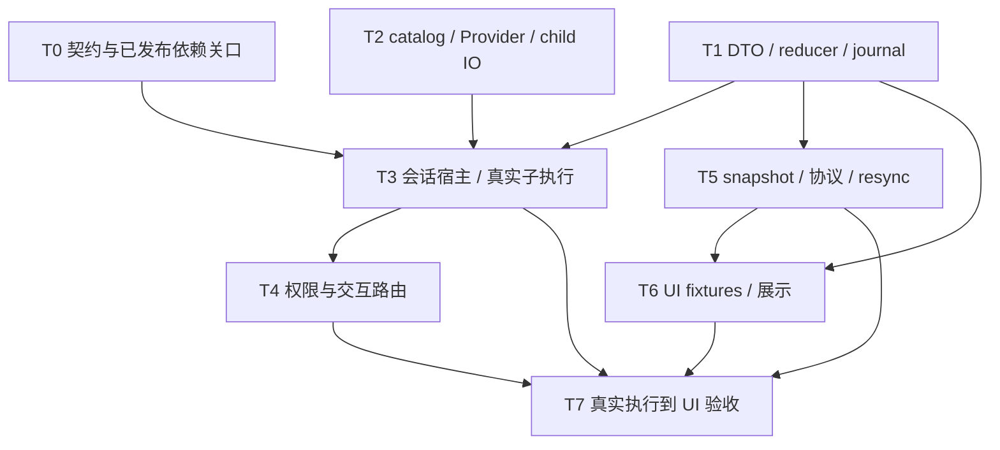

# Sigma Subagent Support Implementation Plan

> **For agentic workers:** 使用并行子任务执行相互独立的工作包；每个 worker 拥有明确文件范围，不能覆盖其他人的改动。协调者串行执行 Mix/Devenv 构建、依赖更新和集成检查。使用 subagent-driven-development 或 executing-plans 跟踪任务；未经另行授权不 commit、push、部署或重启现有服务。

**Goal:** 接入真实、可嵌套的 Codex V2 子代理，并在 UI 可靠显示累计创建数量、执行中列表和保留的已结束状态。

**Architecture:** Backplane MultiAgent 负责子 Conversation 的执行与协作；Sigma 会话宿主负责 catalog/Provider 接线、child IO、权限路由、日志和观察投影。所有可恢复计数来自 durable lifecycle facts 和纯 roster reducer；UI、WebSocket 和 stdio 消费同一个 snapshot/更新边界。

**Tech Stack:** Elixir/OTP、现有 Sigma umbrella、Backplane Agent Runtime、Phoenix LiveView、DuskMoon、现有 JSONL 与 runtime sidecar Store。

**Status:** 2026-10-17 已完成首版既定范围的实现与 scoped 验收。隔离工作树锁定已发布 runtime 1.10.26，#67–#72 关口通过；真实嵌套、follow-up、审批、journal、协议与 UI 已接线。容量拒绝后父任务和已有 children 继续执行，SA-03 正向验收已恢复，未添加本地 workaround。最终综合 346 tests / 0 failures / 0 skipped，另有父会话与前端回归及浏览器证据。Spec/quality review 通过，代码未提交、未合并，原 4580 服务未更换。设计见 [Subagent 支持设计](../specs/2026-10-14-subagent-support-design.md)。

## 1. 已完成的规划与实施边界

- [x] 核对 Sigma `main @ da11993`，实际依赖锁定 1.10.16，现有 Task 为 planned。
- [x] 规划时验证 Backplane 已监督真实 child Conversation、Sigma 尚未接入；当前接入状态以下方实施记录为准。
- [x] 对照 Codex `46fdd5ef39735f4159cdcf0ec5e85c10521494e5`，明确 V2 与 V1 的区别。
- [x] 用户确认支持嵌套；按固定 Codex V2 源码记录默认全树 4 个执行槽含根、子执行槽 3，V2 不另加层数硬限制。
- [x] 提交并核对 [#67](https://github.com/gsmlg-opt/backplane/issues/67)（Feature）、[#68](https://github.com/gsmlg-opt/backplane/issues/68)（Bug）、[#69](https://github.com/gsmlg-opt/backplane/issues/69)（Bug）、[#70](https://github.com/gsmlg-opt/backplane/issues/70)（Feature），均为 `internal request` / blocker。
- [x] 完成各实施任务与 SA-01 至 SA-21 在首版范围内的验收；恢复及生产验证边界见最终记录。

本计划只覆盖设计文档列出的子代理范围。源码文件清单是允许修改的工作边界；若需要新增范围，先在计划中说明原因。只运行对应 scoped tests；范围外失败记录并停止修复，不能顺手维护其他模块。

实施 worktree 放在 `.trees/codex/subagent-support/`，分支使用 `codex/subagent-support`；创建前检查目录和分支是否已存在，复用同一任务的已有 worktree，不覆盖其他工作。并行 workers 共享该 worktree，各自按下列文件所有权工作；依赖目录升级不能污染另一个 worktree。

## 2. 依赖图与可立即开始的工作



T0 的 #67–#72 发布包关口已通过，真实接入与最终验收已在隔离工作区完成。当前代码未提交、未合并，原 4580 服务未更换；保留工作树供审查，不自动进入 Git 发布或部署流程。

建议实际派工为三个责任区：协调者负责 T0/T3 和集成；一个 worker 负责 T1/T5；另一个 worker 负责 T2 的独立测试，随后转 T6。T4 中的 PublicRuntime/SessionLive 接线由协调者串行合并，避免与 T5/T6 同时编辑相同文件。

## 3. 文件与模块职责

以下新路径是规划接口；不存在的上游 observer API 不能按这些宿主名称臆造。

| 工作包 | 新建文件 | 修改的既有边界 |
| --- | --- | --- |
| DTO / projection | `apps/sigma_protocol/lib/sigma_protocol/subagents.ex`；`apps/sigma_session/lib/sigma_session/subagents.ex` | Snapshot；EntryEncoder/EntryDecoder；Writer；Journal/Index；Log |
| 宿主 | `apps/sigma_agent/lib/sigma_agent/subagents.ex` | SessionSupervisor、SessionProcess、Runtime、RepositoryProcess、Sigma.Agent |
| catalog | `apps/sigma_agent/lib/sigma_agent/backplane/tool_catalog.ex` | Backplane.Engine / Provider；Sigma.Agent context builder；两个 Web 入口 |
| child IO | `apps/sigma_agent/lib/sigma_agent/backplane/{child_io,child_store}.ex` | 现有 Provider/tool/hook adapter 的必要身份接线 |
| 审批路由 | 保留在 `Subagents` 宿主和 ChildIO 的工具边界 | PublicRuntime；SessionLive 的回答路径，复用 PermissionInterceptor |
| 公开观测 | 使用上面的 DTO/projection | Envelope；ProtocolEventMapper；ProtocolSubscription；PublicRuntime；SessionChannel；protocol-v1 文档 |
| UI | `apps/sigma_web/lib/sigma_web/components/session_subagents.ex` | SessionLive 的 snapshot、事件、头部入口和详情栏 |

不新增 umbrella app、数据库或第二套 UI 组件库。`MultiAgent` 已监督 child Conversations，宿主不要再造一个执行 supervisor/agent loop。child adapter 仅处理 Sigma IO/context/事件边界。

2026-10-16 实施路径细化：child adapter 实际拆为 `backplane/child_io.ex` 与 `child_store.ex`，协作调用边界为 `backplane/collaboration_backend.ex`；请求路由保留在 session host 与 Runtime，未新增第二个请求进程。T3 补充 `Sigma.Session.SessionFiles` 及 scoped tests：rename/adopt/delete 必须处理 `root.jsonl.subagents/` 子日志与 sidecar，文件操作前确认宿主清理，避免退休仍持有旧路径的 manager/writer。

## T0. 固定契约和上游发布关口

**Owner:** 协调者。**当前：** #67–#72 的发布包关口通过，锁定 Hex 1.10.26。

**Files:** 本计划、设计文档；新增 `apps/sigma_agent/test/sigma_agent/subagent_upstream_contract_test.exs`，用于发布包的真实 Conversation 契约验证和 durable birth 缺口复现；依赖升级时才修改 `apps/sigma_agent/mix.exs`、`mix.lock`；实际观察/额度/中断 callsite 属于 T3。

- [x] 在上游完成 #67 的 process-local host-only snapshot/subscription、lifecycle、watermark 和序列化 payload；durable birth 的剩余契约单列为 #71。
- [x] 在上游完成 #68：V2 执行槽、runtime residency 与历史 identity 分离；嵌套/follow-up 共享根额度，不因完成/中断而永久占槽。发布包 fixture 验证三槽饱和、完成后释放和 follow-up identity。
- [x] 在上游完成 #69：V2 单目标中断；发布包嵌套 fixture 验证后代及兄弟继续运行。
- [x] 在上游完成 #70：发布包 fixture 验证 queue-only idle message、child 到 root 的消息与 terminal result、wait timeout 和 new steer 唤醒。不得把 UI observer 当成模型 mailbox。
- [x] 核对目标包实际发布和包内源文件；锁定 1.10.26，记录 checksum、Codex pin 与行为证据。
- [x] 在上游完成 #71：唯一 birth reservation、dispatch 前的 durable host acknowledgement，以及所有准备后失败和成功创建的关联 receipt；以实际发布包契约 fixture 验证。
- [x] 运行实际包的 observer、执行槽回收、interrupt、mailbox/wait fixtures；Engine 使用 `run_timeout: :infinity`，不保留一小时 ordinary-run workaround。
- [x] 获取修复 #72 的 1.10.26 发布包，验证容量/重复名称/无效 mutating 目标/follow-up 容量拒绝携带实际调用关联的非执行证明；父 Conversation 收到 tool error 后继续，既有 children 不受影响。错误类相同的准备后失败仍保持 uncertain。

`backplane/collaboration_backend.ex` 已移除完成的 #72 TODO，直接传递发布包的 typed rejection；宿主自己已确认的 pre-start receipt 边界保留原实现。不修改 `deps/`、不使用私有 manager state、不实现本地 workaround。

**验证：** `subagent_upstream_contract_test.exs` 的 20 项正向与 uncertainty guards 验证 #67–#72；旧 #72 characterization 已替换。`subagent_host_test.exs` 的 21 项真实宿主测试全部通过，容量继续执行不再 skip。上游自己的包测试在上游任务执行，本仓库不修上游测试的范围外失败。

## T1. 纯 roster 与 operational journal

**Owner:** Session/Protocol worker。**Dependencies:** 无上游 observer 依赖；数据契约采用设计第 4 节。

**Files:** 新 DTO/reducer、`subagent_admissions.ex`；修改 `apps/sigma_session/lib/sigma_session/{snapshot,entry_encoder,entry_decoder,writer,journal,log}.ex`、`journal/index.ex`、`storage/jsonl_file.ex`。Intent/receipt 与附带 public facts 在同一次 fsynced operational append 中确认。

**Tests:** 新建 `apps/sigma_session/test/sigma_session/subagents_test.exs`、`subagent_journal_test.exs`；修改现有 `journal_test.exs`、`journal/index_test.exs`、`writer_test.exs` 的受影响回归。

定义宿主侧纯 API：`Sigma.Session.Subagents.new/0` 返回空 projection；`apply_event/2` 返回 `{:ok, projection}` 或 typed invalid/resync error；`snapshot/1` 返回安全 DTO 与计数。事件含 `fact`、`data`、`event_id`、`revision` 和 `observer_incarnation`，各字段定义见设计。单代理新 run 的 revision 递增、agent identity 不变。

- [x] 写唯一创建、重复 registered、新 run、各 terminal/unknown 状态和跨 incarnation 事件的失败 fixture。拒绝 malformed identity、缺失 run 关联和非法状态。
- [x] 运行 scoped reducer test，确认行为 fixture 失败；实现事件 validation 和纯 fold，重复 event/revision 幂等，不全量 replay。
- [x] 为 `subagent` 的五类 durable facts 编码/解码；append acknowledged 后才更新 projection。
- [x] 更新四处 conversation-node 判定，使子事实与 metrics 一样不推进 leaf、不进入父模型消息；全 root journal 重建 own roster，fork 不计入继承创建数。
- [x] 写真实临时 JSONL 回放、保存失败、重复 replay 和旧日志兼容 fixture；再次运行 scoped tests。

下列是该纯接口的一项验收 fixture，使用测试 helper 产生符合 DTO 的注册事件；helper 只构造数据，不创建 agent：

```elixir
test "duplicate registration does not create another agent" do
  event = %{
    fact: :registered,
    event_id: "birth-1",
    revision: 1,
    observer_incarnation: "owner-1",
    data: %{
      agent_id: "agent-1", agent_path: "/root/survey",
      root_session_id: "root-session", parent_agent_id: "root-agent",
      child_session_id: "child-session", origin_turn_id: "turn-1",
      origin_tool_call_id: "spawn-1", task: "survey", depth: 1,
      agent_type: "default", model: "fixture-model", run_id: "child-run-1",
      incarnation: 1, status: :pending_init, activity: nil,
      closure: :open, created_at: 1000, started_at: nil,
      finished_at: nil, reason: nil
    }
  }

  {:ok, roster} = Sigma.Session.Subagents.apply_event(Sigma.Session.Subagents.new(), event)
  {:ok, duplicate} = Sigma.Session.Subagents.apply_event(roster, event)
  assert duplicate == roster
  assert Sigma.Session.Subagents.snapshot(roster).counts.created == 1
end
```

**Run:**

```sh
devenv shell --no-tui -- mix test apps/sigma_session/test/sigma_session/subagents_test.exs apps/sigma_session/test/sigma_session/subagent_journal_test.exs apps/sigma_session/test/sigma_session/journal_test.exs apps/sigma_session/test/sigma_session/journal/index_test.exs apps/sigma_session/test/sigma_session/writer_test.exs
```

**Done:** SA-04/05 的计数 fold、SA-09 的 terminal 投影、SA-15/16 的历史回放边界通过；本切片不能独自证明真实子执行。

## T2. 统一 catalog 与独立 child IO

**Owner:** Runtime-adapter worker。**Dependencies:** 独立 fixtures 可先做；真实 collaboration catalog 使用 T0 发布包。

**Files:** 新 `backplane/{tool_catalog,child_io,child_store,collaboration_backend}.ex`；修改 `backplane/{engine,provider}.ex`、`sigma_agent.ex` 的必要 context/dispatch 边界。Web 继续使用既有 session options 和静态 Sigma 工具，协作 catalog 由 Engine/host admission 加入，不进行完整工具替换。

**Tests:** 新 `apps/sigma_agent/test/sigma_agent/{backplane_tool_catalog,backplane_child_io,subagent_host}_test.exs`；现有 `backplane_engine_test.exs`、`backplane_context_continuation_test.exs`、Store/tool failure/output error 回归。没有修改 provider wire 协议。

- [x] 写目录不同步的失败测试：把仅存在 Runtime 的 descriptor 放入 catalog，assert 模型请求中出现同一个 admitted tool；被拒绝 tool 同时从 grants/provider definitions 移除。
- [x] 用真实 root/child Provider 并行 fixture 核对 request/message/run identity、工具结果、phase 与 metrics 隔离。
- [x] admitted `registry/tools/authority` bundle 同时供 Provider 与 Conversation 使用；Engine 已接入宿主缓存的 collaboration contracts，不复制 spawn schema。
- [x] child IO 关联请求、独立 Writer/Store/ETS，并通过 ChildStore 投影已提交消息；真实 Conversation 是唯一执行 loop。Sidecar 和 JSONL 为两个存储，报告部分失败而不声称跨存储事务。
- [x] all / none / 正整数 fork 使用完整已提交前缀，不复制未完成工具批次；native collaboration result 在父/子历史中保留 JSON 和安全结构值。
- [x] scoped tests 覆盖 child own usage、请求关联、fresh-run config/resolver 刷新；不把 child usage 加到父 own request。

**Run:**

```sh
devenv shell --no-tui -- mix test apps/sigma_agent/test/sigma_agent/backplane_tool_catalog_test.exs apps/sigma_agent/test/sigma_agent/backplane_child_io_test.exs apps/sigma_agent/test/sigma_agent/subagent_host_test.exs apps/sigma_agent/test/sigma_agent/backplane_engine_test.exs apps/sigma_agent/test/sigma_agent/backplane_context_continuation_test.exs
```

**Done:** SA-06/11/18 的目录、上下文和隔离 fixtures 通过。Fixture adapter 不算实际 MultiAgent 接入证据。

## T3. 会话宿主与真实嵌套执行

**Owner:** 协调者。**Dependencies:** T0、T1、T2。**当前：真实接线与容量拒绝继续执行验收均完成。**

**Files:** 新 `apps/sigma_agent/lib/sigma_agent/subagents.ex`；必要修改 SessionSupervisor、SessionProcess、Runtime、RepositoryProcess、Sigma.Agent；接入 existing Backplane.Store、child Writer 和 session identity。

**Tests:** 新 `apps/sigma_agent/test/sigma_agent/{subagent_host,subagent_upstream_contract,subagent_retirement}_test.exs`；现有 Runtime/Store/terminal operation 回归和 SessionFiles tests。

- [x] 通过公开 API 验证 birth-before-dispatch、spawn failure receipt、nested lifecycle 和 snapshot-watermark，不窥探 manager private state。
- [x] host 管理 Session/MultiAgent generation；对外 run/agent identity 带 generation，child identity/log 稳定，follow-up 使用 fresh run/incarnation。
- [x] reserve/intent/receipt 确认先于 dispatch；intent/receipt 存储故障不启动 Provider，未解决 intent 在重启后阻断执行。
- [x] root -> A -> B -> C 共用三个 child slots；五个顺序任务回收槽位，完成身份 follow-up 不增创建总数。
- [x] 第四个 child 的容量拒绝让父任务继续，既有 children 保留执行；依据 1.10.26 的调用关联证明，不以 generic error 推断非执行。
- [x] 正常 root 完成后 detach/rebind；wait timeout/new steer 不取消 child。
- [x] queue-only child 消息及 terminal result 在 root Provider 边界消费并持久化去重，后续 turn 保留来源。
- [x] 单目标 interrupt 保留后代/兄弟；Stop/close、owner loss、首次 prepare 与 close 交错均有真实宿主 fixture。
- [x] can_stop 与退休先确认关闭；rename/adopt/delete 移动或删除 child artifacts，fork 不复制。竞争目标内容保留并返回 explicit uncertain failure。恢复只 inspect，不重放 prompt/tools。

关键 fixture 通过可控 Provider 的 test mailbox 阻塞执行，用 `assert_receive` 观测 child start 与 durable registration 的先后，再主动释放；不通过 sleep 或“mock 列表有三行”验证执行。阶段需确认实际子 Conversation PID 独立，但 PID 不出现在 UI DTO 或 journal。

**Run:**

```sh
devenv shell --no-tui -- mix test apps/sigma_agent/test/sigma_agent/subagent_host_test.exs apps/sigma_agent/test/sigma_agent/subagent_upstream_contract_test.exs apps/sigma_agent/test/sigma_agent/subagent_retirement_test.exs apps/sigma_agent/test/sigma_agent/runtime_test.exs apps/sigma_agent/test/sigma_agent/terminal_operation_test.exs apps/sigma_agent/test/sigma_agent/backplane_store_test.exs apps/sigma_session/test/sigma_session/session_files_test.exs
```

**Done:** SA-01 至 SA-09、SA-12/13/16/17/21 的真实执行边界有 scoped 证据；SA-03 的发布包、宿主和 UI 正向验收通过。启动/关闭故障覆盖 owner 退休与 unknown 保留，不自动重放或伪造 terminal。

## T4. Child 权限与用户交互路由

**Owner:** 协调者或专属 worker；PublicRuntime/SessionLive 与 T5/T6 的编辑串行协调。**Dependencies:** T3；请求 DTO fixture 可以先写。

**Files:** 请求保留在 `Subagents`，ChildIO 绑定实际 tool call/effective arguments；修改 PublicRuntime、Sigma.Agent、SessionLive 的请求/回答路径；复用现有 PermissionPolicy/Interceptor，不另建请求进程。

**Tests:** `subagent_host_test.exs`、`backplane_child_io_test.exs`、PublicRuntime 回归及 Web `subagent_status_test.exs`。

- [x] 两个 child 同时 ask：回答 A 后 B 仍阻塞，parent phase 不变。
- [x] 请求使用独立 ID；terminal/owner loss 后请求失效，迟到请求拒绝；headless 无 resolver 返回 approval required，显式 resolver 保留行为和 child source。
- [x] session-scoped routing 显示 path/run/incarnation；真实 AskUserQuestion 在 Dispatcher 审批补丁后关联准确 tool ID/effective arguments。
- [x] 复用父 policy，child tools 与 grants 取交集；fresh run 使用新 tool ETS 和当前 resolver，取消/关闭解决 pending waiters。
- [x] 主 agent 的既有 LiveView/PublicRuntime 审批回归随最终 scoped 队列核对；9 项选定 SessionLive 回归通过，不引入额外 timeout/expiry 策略。

**Run:**

```sh
devenv shell --no-tui -- mix test apps/sigma_agent/test/sigma_agent/subagent_host_test.exs apps/sigma_agent/test/sigma_agent/backplane_child_io_test.exs apps/sigma_agent/test/sigma_agent/public_runtime_test.exs apps/sigma_web/test/sigma_web/live/subagent_status_test.exs
```

**Done:** SA-10/11 的交互和拒绝场景通过；Web 来源显示在 T6 组合验证。

## T5. Snapshot、协议 capability 与 resync

**Owner:** Session/Protocol worker。**Dependencies:** T1；host snapshot 的真实 adapter 依赖 T3。

**Files:** DTO 与 `apps/sigma_protocol/lib/sigma_protocol/envelope.ex`；`apps/sigma_agent/lib/sigma_agent/{protocol_event_mapper,protocol_subscription,public_runtime}.ex`；必要修改 SessionChannel；`docs/contracts/protocol-v1.md`。

**Tests:** 新 `apps/sigma_agent/test/sigma_agent/subagent_subscription_test.exs`；修改 `protocol_event_mapper_test.exs`、`apps/sigma_protocol/test/sigma_protocol/codec_test.exs`。回归覆盖 `public_runtime_test.exs`、`backplane_public_runtime_test.exs`、`subscriber_lifecycle_test.exs`、`stdio_test.exs` 和 `apps/sigma_web/test/sigma_web/session_channel_test.exs`，未改动这些既有测试。

- [x] 增加 `subagents.v1` capability、`subagents.changed` event 和带 roster 的 snapshot；先写旧客户端不收到陌生闭合事件的测试。
- [x] Snapshot 契约为 `%{revision: integer, agents: [safe_row], counts: %{created: integer, executing: integer, pending: integer, stopped: integer, unknown: integer}}`；revision 和事件去重身份来自已提交 projection。
- [x] 扩展 subscription-before-snapshot attach，正确缓冲 watermark 后事件；生产 host 经 Runtime 的同一 snapshot 边界接入。
- [x] 终止增量需保留或明确触发 resync；慢 sink/overflow fixture 验证最后一次 terminal 丢失后，无新事件仍能收到有界重试的 resync 提示，并以完整 snapshot 恢复。
- [x] 测试旧 revision、旧 observer incarnation、重复消息及缺口；DTO allowlist 拒绝内部值并移除非展示 host 字段。
- [x] PublicRuntime、stdio、WebSocket snapshot 与 LiveView 的 counts 来源一致，不各自统计。可用 live roster 必须不落后于 durable revision 并覆盖全部 durable identity；旧/禁用 host 不能用空 roster 覆盖历史。

协议保留完整 authoritative roster/counts，不截断历史身份。超出既有 Codec 限制（64 KiB envelope、200 项 collection 或 32 KiB string）时返回 typed `payload_too_large`；未实现分页。失败的 attach 清理新 relay；超限 delta 转为 resync。Owned status 的完整响应在 relay 内先编码验证再解除 block；失败或未请求 roster 的 legacy status 保留原 roster watermark/block/resync，不能假装客户端已恢复。Sink 显式缓冲和单个 retry timer 有界；snapshot loader 阻塞期间的 GenServer mailbox 没有额外容量保证。真实 host、PublicRuntime 与 LiveView 已有组合回归。

**Run:**

```sh
devenv shell --no-tui -- mix test apps/sigma_protocol/test/sigma_protocol/codec_test.exs apps/sigma_agent/test/sigma_agent/subagent_subscription_test.exs apps/sigma_agent/test/sigma_agent/protocol_event_mapper_test.exs apps/sigma_agent/test/sigma_agent/subscriber_lifecycle_test.exs apps/sigma_web/test/sigma_web/session_channel_test.exs
```

**Done:** SA-14/19 通过；旧客户端可正常读取已有会话与事件。

## T6. UI 子代理计数与列表

**Owner:** UI worker；SessionLive 的 T4/T5 接线串行协调。**Dependencies:** T1 DTO、T5、T3；真实事件接入已实现。

**Files:** 新 `apps/sigma_web/lib/sigma_web/components/session_subagents.ex`；修改 SessionLive 的 assigns、snapshot/handler、头部入口与详情栏。保持现有 React Chat 和 details drawer；只在需要时修改对应 session_panels hook。

**Tests:** 新 `apps/sigma_web/test/sigma_web/components/session_subagents_test.exs`、`apps/sigma_web/test/sigma_web/live/subagent_status_test.exs`；现有 `session_live_test.exs` 的相关回归。

- [x] 组件 fixture 覆盖零代理、嵌套、初始化、运行/等待审批、取消中、完成/失败/中断/关闭、需核对。
- [x] summary 显示累计/执行计数和可访问面板入口；列表按 stable agent_id 渲染任务、路径、状态文字、时间与原因，保留终止记录。已挂入 SessionLive 的顶部及详情栏。
- [x] 渲染 counts 直接用 projection，不从 tools 或父 fork 信息估计；没有 capability 时明确说明未接入而不是显示成功的 0。
- [x] 接入 snapshot/增量与 resync，保留展开、输入和滚动状态；显示 child 审批的来源标识。原生 disclosure 的 `open` 用 LiveView `JS.ignore_attributes` 保留，数据行继续更新。
- [x] scoped LiveView 测试验证刷新与状态混合时数量不漂移、孤立审批回答与根 phase 保留。
- [x] 独立测试 endpoint 的 deterministic 会话在 390/1024/1440、sunshine/moonlight 和键盘下检查真实更新；额外复核手动 open/closed 跨筛选与生命周期 patch 保留。不对现有用户会话发计费 prompt，不重启现有 4580 服务。

**Run:**

```sh
devenv shell --no-tui -- mix test apps/sigma_web/test/sigma_web/components/session_subagents_test.exs apps/sigma_web/test/sigma_web/live/subagent_status_test.exs
bun test apps/sigma_web/assets/js/hooks/session_panels_test.js
```

**Done:** SA-01/09/10/14 的 UI 部分及 SA-20 通过。截图仅展示真实测试 fixture 状态，不代替后端执行证明。

## T7. Scoped 完整链路与交付检查

**Owner:** 协调者。**Dependencies:** T3/T4/T5/T6 已在首版范围内通过，T7 最终检查已完成。

**Files:** 真实链路测试保留在已建立的 `subagent_host_test.exs`、`backplane_child_io_test.exs` 与 `subagent_status_test.exs`，不另建重复 integration 文件；设计文档验收矩阵；按实际改动补足上述 scoped regressions。

- [x] 真实 root/MultiAgent/child Conversations、临时 journal/sidecars 和 controllable Provider 覆盖 spawn -> nested -> terminal -> durable projection -> LiveView。宿主测试覆盖 completed/interrupted，真实浏览器同树包含 completed/errored 与审批等待，终止行全部保留。
- [x] 验证 reservation 不重复 dispatch；两个真实子运行写不同临时文件且各自 journal 只含自己的工具历史；五个顺序任务仍可创建，follow-up 不增累计数。
- [x] 测试 observer attach race、slow sink、订阅恢复、刷新、owner restart 与存储 acknowledgement loss；旧 active 行恢复为 unknown，不自动重放。断线网络时序不另声称穷尽。
- [x] 逐项核对 SA-01 至 SA-21，记录恢复/生产验证限制；SA-03 的 #72 发布包与真实链路关口已通过，无剩余 upstream blocker。
- [x] 在一个串行 Mix/Devenv 队列运行实际修改文件的 format check、compile 和 scoped suites；资产经实际 endpoint/browser 与 Bun tests 检查，未扩展为全库维护。
- [x] 检查 `git diff --check`、修改范围与文档链接，记录代码差异、测试证据、依赖版本及恢复限制。当前首版验收完成，保留未提交工作树。

**Run:**

```sh
devenv shell --no-tui -- mix test apps/sigma_agent/test/sigma_agent/subagent_host_test.exs apps/sigma_agent/test/sigma_agent/backplane_child_io_test.exs apps/sigma_web/test/sigma_web/live/subagent_status_test.exs
devenv shell --no-tui -- mix compile --warnings-as-errors
git diff --check
```

Format check 使用实际修改的 `.ex/.exs` 路径作为 `mix format --check-formatted` 参数；避免把无关旧格式问题变成此任务的一部分。compile 的范围外失败列出并停止修复。

## 4. 最终交付条件

- [x] 上游 #67/#68/#69/#70/#71 的已发布修复已进入锁定依赖并通过实际包 fixtures。
- [x] #72 已修复、发布并更新锁定依赖，容量拒绝后父任务及既有 children 继续执行。
- [x] 主/子模型目录与 authority/registry 来自同一个 admission bundle。
- [x] 首版嵌套、槽位回收、消息/结果、follow-up、目标中断和等待行为均有真实运行证据；容量拒绝的完整行为单列 #72。
- [x] 创建/最终状态 durable，刷新与重启历史可恢复；没有自动重放或虚假的 stopped/running。
- [x] UI 可看到是否创建、创建总数、执行列表与所有已结束状态，审批来源正确。
- [x] 新旧 protocol/JSONL、retry/fork 与父会话的选定原行为回归通过。
- [x] SA-01 至 SA-21 与全部 in-scope 检查通过，未验证内容明确记录。

实施进度与验证证据按日期记录在下方；历史 blocker 结论仅适用于当时的包版本，最终状态以 2026-10-17 记录为准。

## 2026-10-15 实施记录

- 已创建 `.trees/codex/subagent-support`，分支 `codex/subagent-support`；保留原工作区及其他 worktree。
- `backplane_agent_runtime` 更新至 Hex 1.10.22（release checksum `0f57ecd0abaf1ebdb6161093a1753b09bb55ed45461009bbbae704c55a75d425`）。没有升级无关依赖。
- 升级后现有 Engine、context continuation、Store scoped 基线共 26 tests，0 failures。
- #67/#68/#69/#70 均已 CLOSED；但 async observer 的实现不能独自满足设计 5.1 的 durable birth 关口。1.10.22 的 `child_options/3` 仍在后续校验前执行，失败可重复 prospective identity，且缺少对应最终 receipt。新增 characterization fixtures 验证此边界；它们通过不代表 T0 通过。
- 真实包八项 fixtures 已验证：前两项 characterization 明确复现异步 observer 提前执行和准备后失败身份复用；另六项验证 snapshot/follow-up、执行槽回收、三槽饱和与嵌套单目标 interrupt、idle queue、child 到 root 的消息/结果及 wait timeout/steer。前两项测试通过代表成功复现缺口，不代表 admission 安全。缺口已提交 [backplane#71](https://github.com/gsmlg-opt/backplane/issues/71)，Feature / internal request / blocker；T3 不以本地 workaround 绕过。
- T1 已完成：DTO/reducer/journal 及相邻编码、索引、Writer、retry/fork/Log 回归共 127 tests，0 failures；包括 lost acknowledgement、重启 Writer 重复 receipt 和 terminal 结果不被后续 close 覆盖。Spec 与 quality review 均通过。
- T2 catalog/Provider 独立切片通过：统一 Runtime admission bundle，quarantine 同时移除定义与 grants，使用每次 request 的 tools/catalog revision；真实默认九项工具可严格准入。Engine 使用已发布的 `run_timeout: :infinity`，保留有限 effect timeout。Child IO、上下文 fork 与并行身份隔离尚未实施，T2 整体未完成。
- T6 独立 DuskMoon 展示组件的 7 tests 通过，spec 与 quality review 均通过；尚未接入 SessionLive，没有浏览器/主题/宽度/键盘验收。
- T5 独立协议切片通过 spec 与 quality review；回归先复现再修复超限快照的假成功/attach 清理、quiet terminal overflow 通知、超限 delta、失败 owned status 提前解除 block，以及 legacy status 未携 roster 却解除 block 的边界。现有 `snapshot/3` 行为兼容；新可信校验 callback 在 relay 串行边界内验证最终响应。
- 最终综合 scoped 验证为 236 tests，0 failures（Protocol 6、Agent 91、Session 127、Web 12；seed `396017`），包含 Engine/catalog、真实发布包 fixtures、stdio、PublicRuntime、SessionChannel、journal/branch/fork 与展示组件。未运行全库测试、计费 live-provider 或现有用户会话。
- `devenv shell --no-tui -- env MIX_ENV=test mix compile --warnings-as-errors` 通过。28 个 touched Elixir 路径的格式检查仅命中 `apps/sigma_session/lib/sigma_session/log.ex` 未修改的 `invalid_retry_boundary` 换行（当前行 366 / HEAD 行 364）；抽取原 HEAD 以相同 formatter 复核得到同一失败，未扩大范围修复。另 27 个路径格式检查通过。
- `git diff --check`、文档本地链接和整体范围检查通过；T1/T2 独立部分、T5/T6 切片与跨模块边界审查均通过。没有 commit、push、merge、部署或重启现有 4580 服务；原 main 仍只保留原先两个未跟踪规划文档。
- 阻塞原因及解除条件已按项目 Agent Note 策略记录为 `1337d5fa-d953-4669-84ae-9bd8c9981ca0`（project `sigma`），已回读核对标签与内容。下一步必须先获取修复 #71 的已发布包，并把前两项 characterization 改为 durable birth 正向验收，之后才能继续 T3/T4/T7 及生产 UI 接线。

## 2026-10-16 实施记录

- Hex 1.10.24 与锁文件一致，#71 同步 receipt-before-dispatch 关口通过，相关 characterization 已替换为正向验收。#67–#71 的十一项真实包 fixtures 通过；新增第十二项 characterization 复现 #72，不能算作期望容量行为通过。
- Session-owned host、统一 catalog、独立 ChildIO/ChildStore、durable admissions、嵌套执行、mailbox、follow-up、单目标 interrupt、Stop/new-generation、孤立审批与 SessionLive 已接入。普通 root 完成不终止 children；确认 cleanup 后才能退休文件和旧 generation。未确认结果阻止新执行。
- ChildStore 以真实 Conversation 为唯一执行 loop，投影 committed messages；native collaboration 结果在父/子模型历史中保留完整 JSON 及安全结构值。AskUserQuestion 关联实际 tool call 与批准后的 effective arguments；每次 fresh run 刷新 config/resolvers，显式 nil 清除旧 resolver。
- Rename/adopt/delete 在 host 确认关闭、Writer flush 后处理 `root.jsonl.subagents/` transcripts 和 sidecars；fork 不复制。跨设备/竞争目的地失败不递归删除未知内容，保留 evidence 并返回 `subagents_cleanup_uncertain`。
- 综合检查曾复现 9 个集成回归：旧/禁用 live projection 覆盖较新 durable roster，以及将 hibernation 与 retirement 混用。修复后，live roster 仅在可用、不落后且覆盖全部 durable identity 时覆盖 replay；idle SessionProcess 可以保留资源休眠，退休检查仍受 terminal/subagent fence 保护。浏览器另外复现 disclosure 被 patch 收起，采用 LiveView 原生 `JS.ignore_attributes("open")` 保留用户选择。
- 最终综合 scoped 检查：**337 tests，0 failures，1 skipped**，seed `4404`（Protocol 6、Agent 178、Session 137、Web 16）。唯一 skip 为 #72 的容量拒绝继续执行用例。日志 `/tmp/sigma-subagent-scoped-final.log`；故障注入工具的预期崩溃日志不计作测试失败。
- 另运行既有 SessionLive 的 9 项指定回归：`319,336,362,412,462,484,2687,2737,2789`，0 failures（其余 78 excluded）。覆盖父聊天/follow-up、批量替换、上下文/usage、回答、allow/deny exactly-once 与刷新待回答。`bun test apps/sigma_web/assets/js/hooks/session_panels_test.js`：7 pass，0 fail。真实两 child 的并发文件写入还验证 live 和各自 JSONL 中的 path/content 与 tool call/result 关联，root 历史不包含 child write。
- 46 个 touched Elixir 文件通过 `mix format --check-formatted`；另一个 touched 文件 `log.ex` 的既有 `invalid_retry_boundary` 换行问题仍按 2026-10-15 的 HEAD 对照证据排除，没有重排无关代码。`MIX_ENV=test mix compile --warnings-as-errors` 和 `git diff --check` 通过。
- 实际受控 Provider endpoint 4591 验证五个已确认 child、嵌套、完成/失败行保留、两条独立审批；回答 A 不解除 B，root 保持 Completed。生命周期更新保留同一 textarea/chat DOM、草稿、selection、focus、滚动位置；open/closed 在过滤和真实完成事件后保持。390/1024/1440 × sunshine/moonlight 检查通过；移动端 focus/Escape 和顶部入口可用，console 无 errors/warnings。当前 served JS `app-e45723a5.js`、CSS `app-ce9ba25b.css`，disclosure 修复只改模板，无需重建资产。
- 浏览器证据：`/tmp/sigma-subagents-final-interactive.png`、`/tmp/sigma-subagents-final-one-pending.png`、六个 `/tmp/sigma-subagents-{390,1024,1440}-{sunshine,moonlight}.png` 和 `/tmp/sigma-subagents-disclosure-retained.png`。最终测试 endpoint 路由为 `http://127.0.0.1:4591/repository/L3RtcC9zaWdtYS1zYWItMTAxNmQvcmVwbw/sessions/browser-fixture`；这里是 deterministic 测试数据。
- Host、SessionFiles、ChildIO、协议和 UI 的 scoped spec/quality review 通过；最后复核快照、休眠、disclosure 及文件历史关联断言。项目 Agent Note `1337d5fa-d953-4669-84ae-9bd8c9981ca0` 更新为 revision 2 并回读核对，保留 1.10.22/#71 历史，记录 #72 当前关口。
- 新的 [backplane#72](https://github.com/gsmlg-opt/backplane/issues/72) 已按 Bug / internal request / blocker 创建，复核仍 OPEN。停止容量拒绝语义的 blocked 部分；不包装 generic error、不匹配错误字符串、不预读容量制造非执行证明。解除条件为上游修复发布、更新依赖，再启用正向容量继续执行测试及相邻拒绝分支验证。
- 恢复证据来自真实 repository/host/Writer 重建与 journal replay；未做完整 BEAM 节点重启演练，不声称恢复旧 runtime identity 或自动续跑。Protocol 超过现有 envelope/collection 限制返回 typed error，未实现分页；不提供全树统一 token 账本。
- 只在 `codex/subagent-support` 工作区修改；未 commit、push、merge、部署，没有替换现有 4580 服务，没有运行计费 provider。临时根 `node_modules` symlink 已移除，未改共享目标。

### SA 核对（截至 2026-10-16）

下表的“通过”限定为上述 deterministic fixtures 和明确的首版范围；不宣称已完成生产部署或真实付费 provider 验收。

| 验收 | 状态与证据 |
| --- | --- |
| SA-01 | 通过：真实嵌套 host 与 LiveView lifecycle tests，顶部创建/执行计数 |
| SA-02 | 通过：root → A → B → C，parent/path/depth 关联 |
| SA-03 | **Blocked：#72，正常容量拒绝继续执行测试 skip** |
| SA-04 | 通过：五个顺序任务，执行槽回收、累计身份保留 |
| SA-05 | 通过：follow-up 同 identity、fresh run/incarnation、创建数不增加 |
| SA-06 | 通过：all/none/数字 fork 和完整 committed 工具批次边界 |
| SA-07 | 通过：真实嵌套单目标 interrupt，后代及兄弟继续 |
| SA-08 | 通过：发布包 timeout、真实 host 的 steer 唤醒，不取消 child |
| SA-09 | 通过：terminal、关闭/owner loss、unknown 保留及 UI 历史 |
| SA-10 | 通过：真实双 child 请求、来源、reload、孤立回答与失效 fencing |
| SA-11 | 通过：catalog authority 交集、配置继承和不支持 override 拒绝 |
| SA-12 | 通过：root 正常完成 detach，下一 turn rebind 与 follow-up |
| SA-13 | 通过：Stop/new-generation、owner loss、首次 prepare/close race |
| SA-14 | 通过：attach race、slow sink/resync、刷新与 stale snapshot 回归；网络时序不声称穷尽 |
| SA-15 | 通过：operational entries 不推进 leaf/checkpoint，retry/fork 不继承 roster |
| SA-16 | 通过恢复边界：repository/Writer 重建、ack loss、不重放；未单独演练完整节点重启 |
| SA-17 | 通过：发布包 receipt gate、intent/receipt 故障、start/catalog 失败 owner 退休 |
| SA-18 | 通过：root/child admitted catalog、独立 request/tool/usage，真实文件及工具历史隔离 |
| SA-19 | 通过：旧 capability/JSONL、stdio/PublicRuntime/SessionChannel scoped 回归 |
| SA-20 | 通过：三种宽度、两主题、键盘、输入/滚动与 disclosure 保留 |
| SA-21 | 通过：queue-only、child/root mailbox、terminal result 来源与持久化去重 |

## 2026-10-17 最终验收记录

- [backplane#72](https://github.com/gsmlg-opt/backplane/issues/72) 已关闭，修复提交 `47981b7475e17dcd0d93fc9d6e92d24d8d7b1d99` 进入 v1.10.26（release commit `5135b878a8f58539df617489824a6a9342f2ff8f`）。隔离工作树只升级 `backplane_agent_runtime`，依赖最低版本更新为 `~> 1.10.26`。实际 Hex outer checksum `965ee3a30d3c9d1f67363c85a3becb4c8db7fb6fbe1ad8d7ffd63a74043c5c5b`，inner `762aaeedd40b85394565284527edad2a0d420f2dd8ec6bd02f5224c49cd39c1f`，Codex pin `46fdd5ef39735f4159cdcf0ec5e85c10521494e5` 不变。
- #72 characterization 已替换为正向契约；发布包 fixtures **20 tests / 0 failures / 0 skipped**。覆盖容量、重复任务名、send/followup/interrupt 缺失目标、已完成 child 的 follow-up 容量拒绝；全部 11 项调用身份/arguments mismatch 被拒绝。Legacy 无完整 identity、reservation 后普通错误和启动后 receipt acknowledgement 失败仍为 uncertain。
- `subagent_host_test.exs` **21 tests / 0 failures**：恢复容量继续执行用例，确认 tool result 为 error、root 下一次 Provider request 出现、三条已有 row 和 admissions 不变、无第四个 child Provider，已有 child 与 root 最终完成。`collaboration_backend.ex` 只移除已完成 TODO，直接接受上游 proof，未增加 wrapper 或容量预检查。
- 新增真实 LiveView SA-03，验证 root+三个 child 满额拒绝、原 Provider 全部存活、无第四行、相同 row IDs 转为 stopped 并刷新保留。首次综合运行暴露测试自身的异步 phase 断言竞争：Provider callback 到达先于 root/LiveView 消费 request-start；改用既有 `assert_eventually` 等待真实 phase 与 DOM，保留全部继续执行断言，不修改产品行为。
- 最终综合 scoped 队列 **346 tests / 0 failures / 0 skipped**，seed `4404`（Protocol 6、Agent 186、Session 137、Web 17）。日志 `/tmp/sigma-subagent-1.10.26-scoped-final.log`。另有指定 9 项父 SessionLive 回归通过（78 excluded），日志 `/tmp/sigma-subagent-1.10.26-parent-regressions.log`；Bun SessionPanels **7 pass / 0 fail**。只运行既定 scope，没有扩展为全库维护。
- 46 个 touched Elixir 路径的 format check、`MIX_ENV=test mix compile --warnings-as-errors`、`git diff --check` 通过。`log.ex` 的既有无关格式问题沿用之前的 HEAD 对照边界，没有格式化无关 hunk。Spec/quality review 对发布包、宿主、调用边界、依赖和新 UI 用例均通过。
- 独立 endpoint 实际加载 `Application.spec(:backplane_agent_runtime, :vsn) == '1.10.26'`，第四个 spawn 展示 `resource_conflict / agent execution limit reached`，root 仍接收模型输出，三个 child 保持 running；已有 child 完成后显示 **3 created / 0 executing / 3 stopped**，无 phantom 创建。Root 最后完成仍保留 draft、selection `9..17`、同一 input DOM、focus 与 footer 位置；面板保持展开，console 无 errors/warnings。
- 测试预览：`http://127.0.0.1:4591/repository/L3RtcC9zaWdtYS1zYWMtMTAxNy9yZXBv/sessions/browser-fixture`，使用可控 deterministic Provider。证据为 `/tmp/sigma-subagent-capacity-{refused,children-stopped}-1.10.26.png` 与 `/tmp/sigma-subagent-capacity-final-1.10.26.png`。CSS/JS 未更改，沿用已验收的 `app-ce9ba25b.css` / `app-e45723a5.js`；之前三种宽度、两主题、disclosure/键盘与审批隔离证据仍适用。
- **SA-01 至 SA-21 在本设计首版范围内全部通过。** SA-03 从 2026-10-16 的 blocked 更新为通过；其他验收保持前表的证据边界并已在 1.10.26 回归。恢复只 inspect、不自动续跑或重放；完整 BEAM 节点重启演练、真实计费 provider、协议分页、全树 token 账本和完整 Codex 工具替换不在此次已验证交付范围。
- 保留分支 `codex/subagent-support` 和工作树 `.trees/codex/subagent-support`，未 commit、push、merge 或部署，原 main 与现有 4580 服务未替换。项目 Agent Note `1337d5fa-d953-4669-84ae-9bd8c9981ca0`（project `sigma`）已更新为 revision 3 并回读核对：#72 已解除，保留 #71 receipt 不变量、generic error 的 uncertainty 语义及未合并/未部署边界。
