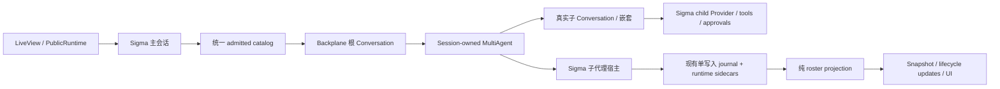

# Sigma Subagent 支持设计

**状态：** 2026-10-17 首版实现与 scoped 验收完成。隔离工作树锁定已发布 Backplane 1.10.26，#67–#72 关口通过；真实嵌套执行与 SessionLive UI 已接线，SA-03 容量拒绝后父任务及已有 children 继续执行。最终综合 346 tests / 0 failures / 0 skipped，其他回归和恢复限制见开发计划。代码未提交、未合并，原 4580 服务未更换。

**日期：** 2026-10-14（Asia/Shanghai）

**规划基线：** Sigma `main @ da119933de162eb8ddcc08315386daa81510e175`，当时锁定 `backplane_agent_runtime 1.10.16`；规划时对比的 Backplane 本地源码为 `5d9217c7` / `1.10.20`。2026-10-17 实施 worktree 已单独升级至 Hex 1.10.26，原工作区未升级。

**用户要求：** 支持真实 subagent；UI 能看到是否创建、创建数量、哪些正在运行和哪些已停止。用户已确认首版支持嵌套，并按 Codex 语义设计。

## 1. 范围与完成标准

首版提供 Codex V2 的 `spawn_agent`、`send_message`、`followup_task`、`interrupt_agent`、`list_agents`、`wait_agent`，通过 Backplane 运行真实子 `Conversation`，包含嵌套子代理。会话顶部显示创建总数与执行数量，详情栏展示整棵代理树及每个代理的任务和真实状态。已结束记录保留，刷新、重连及宿主重启后可以查阅。

默认模型、Provider、工作目录和运行权限来自父代理。上下文 fork、消息和结果传递遵循固定 Codex 版本的契约。并发上限覆盖整棵树，不能让每个子代理各自获得一份新额度。

本次不扩展为完整 Codex 工具替换、分布式调度、自动 worktree/merge、独立子代理聊天页面或可视化手动创建器。BEAM 重启后首版恢复历史和核对状态，不自动续跑原子代理、不重放工具副作用；恢复旧代理身份继续执行需要另一个明确的上游恢复接口。

## 2. 源码事实与方案选择

### 2.1 采用的行为版本

对照 `openai/codex @ 46fdd5ef39735f4159cdcf0ec5e85c10521494e5`，与已安装 Runtime 的 `priv/codex/source-inventory.json` 一致。本轮直接读取了该版本 Git 对象及 V2 handlers，不能把它称为所有 Codex 版本的通用行为。

| 项目 | 固定版本的 Codex V2 行为 | Sigma 接入要求 |
| --- | --- | --- |
| 工具集合 | spawn / message / followup / interrupt / list / wait | 使用 V2 contracts，不混入 V1 close/resume |
| 上下文 | `fork_turns` 默认 `all`，支持 `none`、`all`、正整数串 | 从已提交的父历史构造，不复制草稿或不完整工具调用 |
| 模型与权限 | child config 从父运行配置派生，覆写须经验证 | 默认继承；不自动选另一个模型，不扩大 grants、cwd 或权限 |
| 嵌套 | V2 不使用 V1 的 `agent_max_depth` 限制 | 首版不另加层数硬限制；根为 0，子为 1，以此记录深度 |
| 数量 | 默认 session 并发 4，包含根；有效 child 容量为 3 | 根预留 1，整树共 3 个子执行槽；历史创建总数没有 3 的上限 |
| 完成后 | 执行额度可释放，空闲 runtime 可卸载，身份仍保留 | 不把累计代理数量当并发数量；follow-up 复用身份，使用新 run |
| 等待 | 默认 30 秒、最小 10 秒、最大 1 小时；等待超时仅返回 | 不把 wait 超时转换成子代理取消或失败 |
| 中断 | 中断目标当前任务，保留身份，不遍历后代 | 停一个代理不得顺带停其独立后代或兄弟 |
| 关闭 | V1 close 的递归关闭是另一种操作 | V2 中断、Sigma 会话关闭、整个会话 Stop 分别定义 |

数量 4/3 是本次源码基线的默认值，不是平台物理容量。运行配置将使用一个根会话级 `max_concurrent_threads_per_session`，默认 4，校验为正整数，子执行额度为 `max(value - 1, 0)`；配置为 1 时禁止新的子执行。排队、运行中和已完成分别显示。所有深度共享同一并发额度；每个 run 有独立执行预算，follow-up 延续该 child 的剩余额度而非重置。父 grants 是上界，不据此宣称存在全树统一 work/token 扣账；Goal 的聚合预算不属于首版。

### 2.2 可选接入路径

| 路径 | 收益 | 代价与结论 |
| --- | --- | --- |
| Backplane V2 + Sigma 宿主适配 | 复用已有执行、授权、wait、历史接续和 session binding | 需要补齐上游观测、容量与中断契约；本方案采用此路径 |
| Sigma 自己实现 Task/嵌套 agent loop | 可以直接套用当前 Sigma 工具层 | 会重复执行内核、生命周期和协议；不作为本次实现路径 |
| 先完成全部 Codex 工具替换再做 subagent | 最终目录统一 | 扩大为 Code Mode、services 等独立任务；本次只完成协作需要的 catalog/provider 接线 |

现有 `.trees/codex-tools-plan` 的完整替换计划继续独立存在。本方案实现其中协作相关边界，不宣称完成全量工具迁移，也不删除现有工具实现。

### 2.3 规划时发现的上游关口

| Issue | 已核实的差异 | 阻塞范围 |
| --- | --- | --- |
| [backplane#67](https://github.com/gsmlg-opt/backplane/issues/67) · Feature | 没有宿主完整 snapshot/subscription；仅部分 terminal 通知；创建/替换/显式中断/关闭/DOWN 不完整 | 可靠 birth、全量 roster、实时计数及恢复关联 |
| [backplane#68](https://github.com/gsmlg-opt/backplane/issues/68) · Bug | `capacity/1` 计入所有非 shutdown 身份；V2 无 close，完成代理最终耗尽创建容量 | 有界并发、连续多任务及嵌套额度复用 |
| [backplane#69](https://github.com/gsmlg-opt/backplane/issues/69) · Bug | V2 interrupt 共用递归 `cancel_owned_tree/3` | 嵌套代理的单目标中断语义 |
| [backplane#70](https://github.com/gsmlg-opt/backplane/issues/70) · Feature | message 走 steer、不能送 idle/root；缺少 parent terminal mailbox；wait 不监听 root steer | queue-only 通信、父子结果传递与 wait 唤醒 |

四项均以 `internal request` 和 `blocker` 提交，上表保留规划时的差异，发布包修复状态以下节为准。验证采用 deterministic Provider，不调用计费 live-provider。恢复旧身份继续运行的 manager restore API 也不存在，但不阻塞首版明确限定的历史查阅与非自动恢复。

Blocked 任务等待 issue 修复、发布包、Sigma 更新锁定依赖及 scoped 验证通过。不得通过读取私有 GenServer state、模拟模型调用 list、修改 deps、注入 V1 close 或调大上限绕过。纯 DTO、journal、协议和 UI fixtures 的独立工作可以继续。

### 2026-10-15 发布包复核

#67/#68/#69/#70 均已 CLOSED，Sigma 实施 worktree 已锁定 `backplane_agent_runtime` 1.10.22（release checksum `0f57ecd0abaf1ebdb6161093a1753b09bb55ed45461009bbbae704c55a75d425`）。包内 MultiAgent 与上游 `0f0aa131` 一致。八项真实包 fixtures 已验证 snapshot/follow-up、三槽饱和与回收、嵌套单目标中断、idle queue、child 到 root 的消息/结果及 wait timeout/steer。Observer 的 process-local roster 已可用；但第 5.1 节的完整 durable birth reservation/ack/receipt 仍缺失：异步 observer 等待持久化时 child 已执行，准备校验失败后没有最终 receipt，同任务重试会复用 prospective identity。前两项 characterization tests 通过表示成功复现缺口。该缺口已提交 [backplane#71](https://github.com/gsmlg-opt/backplane/issues/71)（Feature / internal request / blocker，2026-10-15 复核仍 OPEN）。因此真实宿主接线继续等待 #71；不把旧 issue 关闭作为此关口通过的证据。

### 2026-10-16 发布包关口通过

#71 已关闭（04:10:39 UTC），Hex 1.10.24 已发布（04:43:45 UTC）。锁定 package outer checksum `edf090af579bff636f9e4d8c92a76af145706fb6fb300cda6158f10ecafef7dd`，inner checksum `886097da0fd59ea1c2ba52b908511315781c647f9f3ced1e96aa12150ea99326`。实际包十一项 fixtures 验证独立 reservation、intent 后的关联 rejection/start failure、created receipt 同步确认先于 prompt dispatch，及 #67–#70 的行为。`child_options/3` 与 `admission_receipt/1` 均在 manager 串行 admission 内调用；callback 及同步下游不得回调 manager。实际 `:created` receipt 才能确认出生，异步 observer 的 `:created` 仍属 provisional。

宿主把 intent/receipt 与公开 facts 放在一个 Writer 的 operational append 中，文件数据 sync 后确认；sidecar 与 child JSONL 是有序的独立确认，不承诺跨文件原子事务或目录 fsync。Manager 的原始 run ID 可跨 generation 重复，公开 agent/run ID 加 generation 前缀。

### 2026-10-16 新发现的容量拒绝阻塞

1.10.24 在容量已满时先返回 generic Error，尚未分配 reservation，也不调用 `child_options/3` 或产生 invocation-bound receipt。Conversation 对 mutating tool 的 generic error 必须按未确认结果处理，随后取消父 run，并关闭该 session 的 children；不能据此宣称普通容量拒绝后父任务仍可继续。

真实包的 `subagent_upstream_contract_test.exs` 以 root-inclusive limit 1 验证没有准备回调、receipt 或 admissions，settlement 为 `:uncertain`；真实宿主在默认三个 child 槽饱和后也复现父 run 取消。缺口已提交 [backplane#72](https://github.com/gsmlg-opt/backplane/issues/72)（Bug / internal request / blocker），对应容量继续执行用例明确 skip 并链接 issue。该 characterization 通过表示复现问题，不是 SA-03 通过。

需要上游发布可信、绑定实际调用的非执行证明，并核对重复名称、无效 mutating target 与 follow-up 容量拒绝等相邻分支。宿主不得按错误字符串、预先读取容量或包装普通错误制造 `ToolEffects.reject`。blocked 部分等待 issue 修复、发布包和 Sigma 锁定依赖更新。

### 2026-10-17 容量拒绝关口通过

#72 已关闭，修复提交 `47981b7475e17dcd0d93fc9d6e92d24d8d7b1d99` 进入 v1.10.26，Sigma 已锁定实际 Hex 包。Outer checksum 为 `965ee3a30d3c9d1f67363c85a3becb4c8db7fb6fbe1ad8d7ffd63a74043c5c5b`，inner 为 `762aaeedd40b85394565284527edad2a0d420f2dd8ec6bd02f5224c49cd39c1f`，Codex pin 不变。

可信 backend 对显式 pre-dispatch 拒绝返回 `ToolEffects.Rejection`，绑定 run/incarnation/step/attempt/invocation/tool revision/catalog revision/tool call/turn 与完整 arguments；执行边界核对后返回正常 tool error。此时没有 child 准备或启动，不需要制造 birth receipt，也不增加创建数。缺少完整 identity 的 legacy 调用、准备/reservation 后的普通错误、已启动后 receipt 失败仍保留 uncertain；不能把错误类或文本本身当成非执行证明。

发布包 20 项 fixtures 验证早期容量、重复名称、缺失 mutating 目标、follow-up 容量拒绝、全部 11 项 identity/arguments mismatch，以及 uncertainty guards；真实宿主 21 项测试通过。SA-03 的 root+三个运行 child 再请求第四个 child 时，父任务收到 tool error 并继续，三个既有 child 均能完成，UI 创建数保持 3、停止行保留，刷新不丢失。旧 characterization 已替换，skip 和 callsite TODO 已移除；无本地 workaround。独立浏览器实际加载 1.10.26 复核相同行为。

## 3. 运行与宿主职责

### 3.1 进程与资源所有权

- 子代理宿主放在 `Sigma.Agent.SessionSupervisor` 的会话监督边界内，生命周期长于一次 root turn；不放在 LiveView 或一次工具 Task 中。
- 使用 `Backplane.AgentRuntime.Codex.Session` 的 bind/attach/detach/rebind 维护跨 root turn 身份。普通完成允许后续 turn 使用既有代理；失败、取消、owner death 和不确定 settlement 遵循 Session 的关闭/核对边界。
- 宿主适配：Codex.Session 关闭不可逆。用户下一次显式 prompt 可在已确认清理后创建新 generation；旧行保留，新身份不冒充原代理。未确认清理或恢复中的未决 admission 阻止新一代执行。
- `MultiAgent` 监督并推进子 `Conversation`。Sigma 提供 Provider、工具、审批和持久化薄适配，不再另外启动一个 Sigma.Agent 来推进同一个子 run。
- 每个子 run 的适配消息带明确 agent/run/incarnation/request 身份，不能沿用主引擎的未区分 owner 握手。父子 Provider/tool 回调不得更新彼此的 state 或互相等待回复。
- 会话关闭先拒绝新工作、请求清理，再根据 confirmed/uncertain receipts 发布结果。监督重启不能重新执行原始 prompt。
- 现有 SessionSupervisor 的 `max_restarts: 0` 与 `can_stop/1` 要一起审视；仍有子执行或未确认清理时不能把宿主当作可安全退休。
- 空闲 SessionProcess 的 BEAM hibernation 保留监督树和子资源，可以正常休眠；它不调用资源退休检查，不能与 session close/stop 混为一谈。

### 3.2 Catalog 与 Provider

规划基线的 `Sigma.Agent.Backplane.Engine.registry/2` 来自 `state.tools`；Provider 的 `__backplane_build_context__/2` 又从 `state.tools` 独立构造定义。仅注册 MultiAgent descriptors 不会让模型看到协作工具。实施已统一 admission bundle，并由 session host 为 Backplane Engine 提供真实协作 contracts。

接入时使用 Runtime contracts/admission 组合现有工具 descriptors 和协作 contracts，把同一份 `registry`、`tools`、`authority` bundle 同时送给 Conversation 和 Provider context。请求携带该次 catalog revision；禁用的 capability 不出现在模型目录中。协作不添加到静态 `Sigma.Tools.default_tools/0` 里冒充普通模块，也不为本次替换全部现有工具。

`SessionLive` 和 `ProtocolSessionOptions` 两个入口采用同一宿主配置。子代理使用同样的目录事实和适用的权限子集；动态 MCP/skill 激活仍经现有校验边界，不能复制父进程 ETS 或已消费的一次性授权。

### 3.3 上下文、日志与工作目录

子代理有独立、稳定的 child session identity、JSONL 与 runtime sidecar run 记录，并关联 root session、parent agent、发起 turn/tool call。`agent_id` 不等于 `run_id`；follow-up 保留 agent identity 和历史，换新 run ID，不增加创建计数。

首版只支持继承已配置的模型和 default agent type；显式请求其他模型、role 或 reasoning override 返回结构化不支持结果，不静默忽略。fork 使用已提交且工具 call/result 完整的父历史前缀；当前 spawn 所在尚未完成的工具批次不作为继承授权或伪造结果带入。

父子默认共享当前有效 cwd，与对照版本的继承行为一致。首版不自动创建 worktree，也不承诺跨代理文件事务。现有 ToolScheduler 的 `exclusive` 是单个 batch 内的调度信息，不能宣称它提供整棵树的文件锁。验证并行修改不同文件；同一文件写入遵循现有工具契约和明确的任务归属。

子输出保存在子日志，只把协议规定的消息/结果交付给父模型；不把子消息逐条混入父聊天流。Provider/metrics 使用 child origin，父 own usage 与 child usage 保持可区分，避免同一请求重复计入父账。

`send_message` 采用 queue-only，运行中或空闲目标均不会因此自动开始新 turn；child 可以在已认证树内给 root/parent 发消息。`followup_task` 才是显式继续任务的操作。Terminal result 按固定 Codex 的 parent mailbox 边界交付，保留 source/run/result 关联及接收结果；该源码行为是 best effort，不承诺 durable exactly-once。Host UI 的生命周期通知不是模型 mailbox，不能用 #67 替代 #70。V2 wait 同时观察 mailbox/new steer，醒来只结束等待，不终止子执行。

### 3.4 审批路由

现有 PublicRuntime 与 SessionLive 回答路径只定位主 agent。新增会话级请求路由，身份至少包含 `request_id`、`agent_id`、`run_id`、`incarnation`、`tool_call_id` 及已校验参数关联。UI 的审批问题标明来源代理。

两个子代理同时请求审批时，各自保留待答记录；回答一个不能放行另一个、父代理或旧 run。父规则和用户授权不因委派扩大；持久化恢复不复活旧授权。无交互 resolver 的 headless 调用保持 `approval_required` 行为，不能自动批准。

不增加本功能专用的审批过期策略；沿用项目现有策略，任何按目标 Codex 生命周期调整的变化单独记录来源和验证。

## 4. 权威 roster 与计数

### 4.1 数据契约

下列是 Sigma DTO 设计，不是尚未发布的上游 API 名称：

| 字段 | 含义 |
| --- | --- |
| `agent_id` / `agent_path` | 稳定身份 / 可读嵌套路径；路径相同的新宿主 incarnation 不得复用旧身份 |
| `root_session_id` / `parent_agent_id` / `child_session_id` | 归属及可查阅的子日志身份 |
| `origin_turn_id` / `origin_tool_call_id` | 创建来源；不是当前子 run ID |
| `task` / `agent_type` / `model` / `depth` | 当前任务与配置的可展示部分 |
| `run_id` / `incarnation` | 当前一次执行及 fencing 身份 |
| `status` / `activity` / `closure` | 执行结果、当前阶段、资源清理是否确认，分别保存 |
| `created_at` / `started_at` / `finished_at` | 实际采集的 Unix 毫秒时间；缺失保留 nil |
| `revision` / `event_id` / `observer_incarnation` | 去重、顺序及拒绝旧宿主回调 |
| `reason` | 可安全展示的失败/中断/核对原因 |

`status` 展示值包括 `pending_init`、`running`、`cancelling`、`completed`、`errored`、`interrupted`、`shutdown`、`unknown_outcome`。`pending_init/running/completed/errored/interrupted/shutdown` 对应实际 runtime 事实，`cancelling` 和 `unknown_outcome` 是宿主展示投影，不能伪装成 runtime 已确认 terminal。`activity` 可表示等待模型、工具、审批或其他代理；没有采集就显示未知，不通过文本猜测。

### 4.2 计数定义

- **累计创建：** 当前 root session 所有确认创建的唯一 agent identity，包含嵌套与已关闭代理。Birth intent/拒绝的 spawn 不增加；follow-up、重试子 run、重复事件不增加。
- **执行中：** 当前 run 已确认 running，或取消仍未确认结束；等待审批/模型/其他代理仍属于未结束执行，行内显示具体等待原因。
- **初始化：** 已确认创建而仍 pending_init 的代理；独立列出，不能显示成已运行。
- **已停止：** 已确认 completed、errored、interrupted 或 shutdown 的代理。列表区分“完成”“失败”“已中断”“已关闭”。完成后可以仍可接收 follow-up。
- **需核对：** 无法确认执行/清理的 unknown_outcome；不算作已停止，不假装仍在运行。

所有聚合由同一 roster reducer 得到，UI 不自行遍历 tool calls 或 fork lineage 推算。根 session 中不同 retry 分支的子代理保留来源关联；切换旧分支不抹掉真实执行历史。新 fork 的 own roster 从零开始，继承的引用不是新 fork 创建的代理。

## 5. 持久化与恢复

### 5.1 Birth 与 lifecycle

必须有可串行化 birth reservation/intent，在子 prompt 或工具副作用开始前由宿主持久化确认；随后收到确认创建或失败的 receipt。1.10.24 的 `child_options/3` 获得已消耗的唯一 reservation；仍在 authority/start/prompt 校验之前执行，所以 intent 不能独自充当确认创建来源。#71 的同步 created receipt 在真实 Conversation 启动后、prompt dispatch 前由宿主确认。

新 operational journal entry 采用 `type: "subagent"`，facts 为 `registered`、`run_started`、`run_finished`、`closed`、`recovered`；外层 entry 继续遵循现有 v3 id/parent/timestamp 编码。不持久化每个文本 delta。阶段增量可重新从 live snapshot 获取，创建和最终结果必须能从 durable facts 重建。

使用现有 Writer 的单写入边界，append 确认后才推进可恢复 projection 和发布已提交事实。若 host append 失败，暂停对应 admission/展示发布并保留恢复证据，不能返回假成功。

Operational entries 不推进 conversation active leaf、不进入模型消息、不改变 retry/fork checkpoint。必须同步更新 Writer、Journal、Journal.Index 和 Log 的 conversation-node 判定。EntryEncoder 不能落入 `:ignored`；目前 ignored 仍会通知 UI，所以仅 live 测试通过不能证明持久化成功。

保持旧 JSONL 可读并验证新记录的兼容行为；不在打开页面时迁移旧日志。运行 sidecar 与展示 JSONL 的确认次序及重放去重必须有故障注入 fixture，不把两次文件 append 宣称为跨文件原子事务。

### 5.2 重连与重启

先建立订阅，再取得带 watermark 的完整 snapshot，应用其后的更新。重复/旧 incarnation 事件忽略；缺口、overflow 或 revision 不连续触发 resync，不继续维护不可靠计数。

刷新或 LiveView 退出只影响观察，不是取消。BEAM/owner 重启加载 durable roster 和 runtime evidence：原 terminal 记录保持；原 active 记录先显示“需核对”，经检查确认未执行/已终止再记录相应恢复结果。所有恢复操作都是 inspect/reconcile，不自动发送原 prompt 或执行工具。

当前 MultiAgent 无 tree restore API；首版不让旧 identity 在新 manager 中假装仍可 follow-up。新宿主 incarnation 的新工作使用新身份，旧记录仍可查。若将来要求无缝继续旧身份，另行请求并验证 manager recovery API。

## 6. UI 与公开协议

头部始终提供可发现的 Subagents 入口及计数，即使详情栏收起；未创建时显示 0 或“尚未创建”，不能用空列表掩盖功能不可用。详情栏使用现有 DuskMoon 组件展示嵌套关系、名称、任务、状态文字、等待原因和开始/结束时间。终止行保留，并可按执行中/已停止/需核对筛选；窄屏沿用详情 drawer。

UI 仅消费 authoritative snapshot/delta；高频内容更新不能重置输入、展开状态或页面滚动。状态不只依赖颜色，键盘可打开/关闭面板。完整子聊天页面、手动 spawn 按钮不在首版范围。

新增 capability `subagents.v1`，仅对声明该能力的协议客户端发送 `subagents.changed` 并在 `session.snapshot` 加入 roster。旧客户端仍接收原事件集合，避免闭合 enum 拒绝新事件。PublicRuntime、stdio、WebSocket 和 LiveView 采用同一 runtime 查询及审批路由；终止增量丢失时必须能从 snapshot 恢复。

整个会话 Stop 沿用 root cancellation / Codex.Session 的宿主资源清理边界，等待确认再显示结束。单代理 V2 interrupt 仅影响目标当前任务，wait timeout 不改变状态。导航离开与会话退休不同；真正关闭/退休时必须检查仍活跃的子资源。

## 7. 验收矩阵

| ID | 场景 | 必须看到的结果 |
| --- | --- | --- |
| SA-01 | 创建三个真实 child，阻塞 provider | 顶部总数 3、执行数 3；三个独立 Conversation |
| SA-02 | A 创建 B，B 创建 C | 路径/parent/depth 正确，共享全树额度 |
| SA-03 | 超过并发容量 | 返回可信拒绝，父任务与既有 children 继续；无 phantom 创建、无额外执行。1.10.26 的发布包、真实宿主与 UI 验收通过 |
| SA-04 | 多次完成后持续创建 | 新任务可继续运行；历史总数增长而执行槽回收 |
| SA-05 | 对已完成代理 follow-up | 同一 agent、新 run、保留历史，总数不增加 |
| SA-06 | all / none / 数字 fork | 上下文与已提交父边界一致，非法值拒绝 |
| SA-07 | 单目标 interrupt，有后代和兄弟 | 目标确认中断，后代/兄弟按 V2 继续 |
| SA-08 | wait 超时/被 steer 唤醒 | 仅 wait 返回；子运行不被取消 |
| SA-09 | 完成、失败、进程崩溃、取消、关闭 | 保留唯一行和原因，无永久 running 或假 stopped |
| SA-10 | 两个 child 同时审批 | 标明来源，回答不串线，旧请求不能放行新 run |
| SA-11 | 权限与配置继承 | child 不能扩大父 grants/cwd；不泄露或复制授权凭据 |
| SA-12 | 父正常完成后下一 turn | binding 正确移交，子 identity 可继续使用 |
| SA-13 | root Stop / session close / owner death | 关闭 admission，核对清理，未确认结果保留 unknown |
| SA-14 | refresh / reconnect / slow observer | snapshot+watermark 恢复一致，无漏计和重复 |
| SA-15 | operational journal + retry/fork | leaf/checkpoint 不变，子 facts 不进入父模型消息 |
| SA-16 | BEAM 重启和存储 ack 丢失 | 历史恢复，active 核对，不自动重复副作用 |
| SA-17 | Spawn/start 前后注入失败 | birth intent/receipt 对应，不能丢失已启动身份 |
| SA-18 | Provider catalog 和指标 | root/child 看到正确工具；child request 不重复计父 own usage |
| SA-19 | 旧协议客户端/旧 JSONL | 原功能可用；新 capability/events 可明确协商 |
| SA-20 | 390 / 1024 / 1440、明暗主题与键盘 | 面板可发现、状态可读、无输入/滚动回退 |
| SA-21 | child -> root 消息、idle queue、terminal result | queue-only，不触发新 turn；来源可关联，重复/拒收结果明确 |

验收使用实际 MultiAgent/Conversation、可控制的 deterministic Provider 和真实临时文件，不需要 live-provider 计费调用。仅组件 fixtures 通过不能替代真实 root -> spawn -> child -> durable event -> UI 验收。

## 8. 证据索引

- Sigma：`apps/sigma_tools/lib/sigma_tools{,/catalog}.ex`；`apps/sigma_agent/lib/sigma_agent/backplane/{engine,provider,store}.ex`；`sigma_agent.ex` 的 context/dispatch 边界；SessionSupervisor / SessionProcess。
- UI/入口：`apps/sigma_web/lib/sigma_web/live/session_live.ex`；`protocol_session_options.ex`；PublicRuntime 的 permission.resolve/prompt_opts。
- Durable/协议：EntryEncoder/EntryDecoder、Writer、Journal/Index、Log、Snapshot；Envelope / ProtocolSubscription / ProtocolEventMapper。
- Runtime：已安装 Hex 1.10.26 的 `codex/{multi_agent,session,backend,profile,catalog}.ex`、`tool_effects.ex`、`conversation.ex`、`EMBEDDING.md`、`PERSISTENCE.md`；1.10.20 diff 仅作规划历史。
- Codex：上述 pin 的 `tools/handlers/multi_agents_v2/{spawn,list_agents,interrupt_agent,wait}.rs`、`multi_agents_spec.rs`、`agent/child_config.rs`、`agent/control/{interrupt,execution,residency,legacy}.rs`、`config/mod.rs`。
- 上一轮计划只作历史背景：`.trees/codex-tools-plan/docs/superpowers/plans/2026-10-07-codex-tools-replacement.md`。旧 issue #52 已 CLOSED；本轮核对当前 Session binding 源码后才采纳。
- 实施验证：`subagent_upstream_contract_test.exs`、`subagent_host_test.exs`、`backplane_child_io_test.exs`、`subagent_subscription_test.exs`、`subagent_retirement_test.exs`，以及 Session journal/SessionFiles 与 Web `subagent_status_test.exs`。2026-10-17 最终 scoped 346 tests / 0 failures / 0 skipped；SA 逐项状态、其他回归及浏览器证据见开发计划的当日记录。

对应实施任务见 [开发计划](../plans/2026-10-14-subagent-support.md)。
